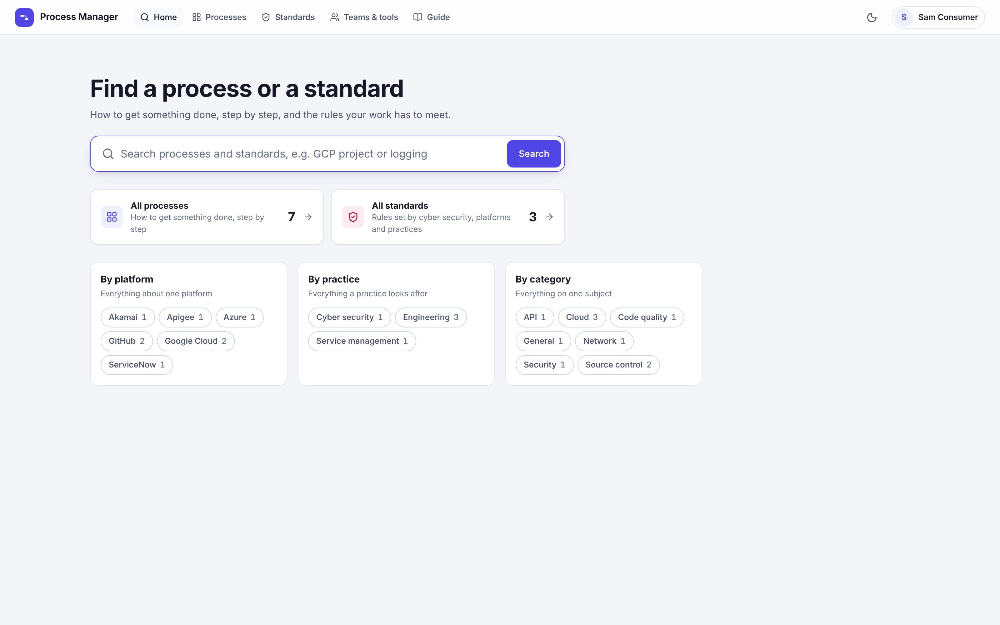
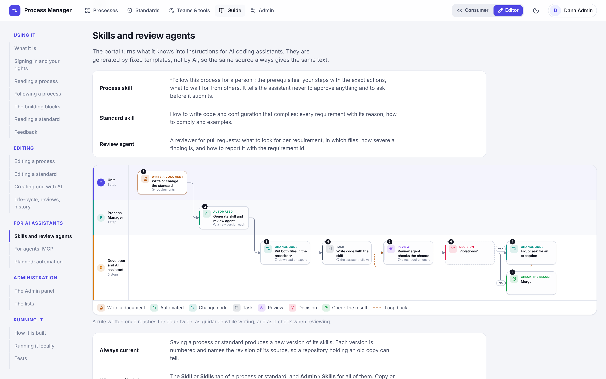
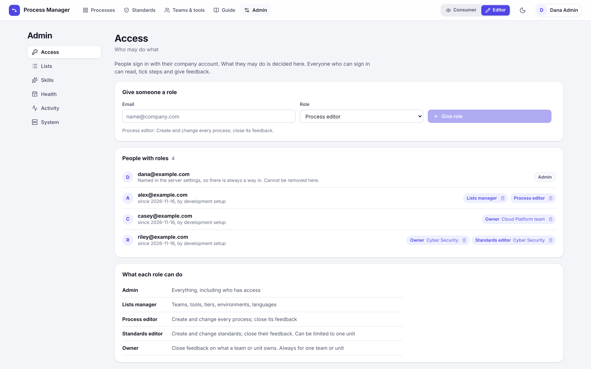

# Process Manager

A portal for two questions:

- **“How do I get…?”** A **process** (request a GCP project, a repository, an Akamai onboarding…) shown as a swim-lane map, where the first lane is always you, and as a checklist with the exact actions.
- **“What must I meet?”** A **standard** (the rules of cyber security, a platform or a practice): requirements with the reason, how to comply, and how each is checked.

The home page is one search over both, with filters by type, rigour, category, practice and platform.

From both, the portal generates **skills for AI coding assistants** and, for standards, **pull request review agents**, and keeps them up to date as the content changes.




## Run it locally

You need Node 22, Go 1.26 and Docker.

```bash
npm install
```

```bash
npm run dev
```

Open http://localhost:5173 and pick who to be:

| User | Rights |
| --- | --- |
| Sam Consumer | Reads, follows, reports problems |
| Alex Editor | Edits processes and manages the lists |
| Casey Owner | Member (Owner) of the Cloud Platform team: confirms reviews, closes feedback on what it maintains |
| Riley Security | Practice owner of Cyber security: changes what belongs to it; member of the Cyber Security team |
| Jordan Platform | Reader who is Platform owner of Google Cloud, Practice owner of Engineering and member of the Cloud Platform team |
| Dana Admin | Everything, including who has which role |

`npm run dev` starts three things in one terminal: a Postgres container (docker compose, port 54329), the Go server (rebuilt and restarted when a `.go` file changes) and Vite with hot reload. An empty database is filled from the sample content in `processes/`, `standards/` and `catalog/`.

| Command | Does |
| --- | --- |
| `npm run db:reset` | Empties the feedback and adds the samples again |
| `npm run db:import` | Loads the files of the repository over what is in the database |
| `npm run db:demo` | Loads a larger demo set (`demo/`: 15 more processes and 9 more standards, more teams, platforms and practices) the same way, to try search, filters and My responsibilities. Its lists replace the stored ones; `db:import` afterwards puts back the smaller sample lists |
| `npm run db:migrate` | Upgrades the database and its content to this version, says what it did and exits |
| `npm run export -- <folder>` | Writes the content and the generated skills to files |

To use a Postgres you already run instead of Docker, set `PM_PG`, for example `PM_PG=postgres://pm:pm@localhost:5432` (it needs the databases listed in `docker/init-databases.sql`). To try real sign-in locally, set `PM_AUTH=entra` or `google` with the variables in `.env.example`, and register `http://localhost:5173/auth/callback` with the provider.

## How it is built

React + Vite frontend; Go server; Postgres. Everything people change lives in the database: processes, standards, the lists, roles, feedback and the generated skills. Every save is a numbered version with a note; a save made from an outdated version is refused, so two people never overwrite each other. The files in this repository are the code, the formats (`schema/`) and sample content for a first start. A database filled by an earlier version is converted by the server at its first start. Details, API and settings: [`docs/backend.md`](docs/backend.md).

## What is in it

| | |
| --- | --- |
| **Search** | Home (`#/`) searches processes and standards together; results (`#/search?…`) filter by type, rigour, category, practice and platform, and the address holds the whole search so it can be shared. The process list is `#/processes`, standards `#/standards` |
| **Processes** | Map and checklist, sub-processes, prerequisites, block types, editing on the map and in the checklist |
| **Standards** | Requirements with level (must / should / may), reason, how to comply, examples, how it is checked, and what a reviewer looks for |
| **What it belongs to** | An owning team, and optionally a category, a platform and a practice; a process also has a rigour, how binding it is (mandatory, recommended, optional), a standard follows from its requirements' levels |
| **Where it applies** | Application tiers, environments and programming languages, on a process, a standard or a single requirement; “My application” hides the rest |
| **Life-cycle** | Draft (hidden from readers), active, retired; periodic reviews by the owner |
| **Versions** | Every save is a version with who, when and a note; what changed between versions in plain words; restore; undo while editing; a warning before unsaved changes are left; a decision when somebody else saved first |
| **Feedback** | On a step or a requirement, “I hit this too”, closed by the owner, flagged when the text changed since |
| **My responsibilities** | For owners: reviews to do, feedback waiting, drafts, and everything of their teams, platforms and practices, on one page with a count in the top bar |
| **Skills** | Generated per process and per standard, versioned automatically, with optional hand-written guidance |
| **Admin panel** | Roles, the lists (teams, practices and platforms with their members, categories, tools, tiers, environments, languages), the skills registry, health, activity |
| **AI authoring** | A self-contained prompt for any chat assistant turns text into a process or a standard; the checker validates what comes back |


The in-app **Guide** (top bar) is the main documentation and describes all of this, with flow charts drawn by the app's own map.



## Roles

Everyone who signs in (Entra ID or Google) can read, tick and give feedback. Roles are given in **Admin › Access** and stored in the database:

| Role | Adds |
| --- | --- |
| Owner (of one team) | Confirm reviews and close feedback on what the team maintains; a page of their own, **My responsibilities**, shows what is waiting |
| Platform owner (of one platform) | Create, change and delete the processes and standards that belong to the platform, and everything an Owner does for them |
| Practice owner (of one practice) | The same for one practice |

A platform or practice owner may set or change the platform of a process or standard only from one of their own platforms to another (or to or from none): a platform that is not theirs stays as it is, and only its owners or an editor can change it. The same goes, separately, for the practice. They may change everything else, the owning team included; editors are not limited this way.
| Process editor | Create and change every process |
| Standards editor | Create and change every standard |
| Lists manager | Teams, practices, platforms, categories, tools, tiers, environments, languages |
| Admin | Everything, including roles |

The members of a team, platform or practice are the people with Owner, Platform owner or Practice owner for it. Admins add them on the entry in **Admin › Lists** or person by person in **Admin › Access**; everyone can see them under **Teams & tools**. One person can be in a team, a platform and a practice at once. The rules in detail: the Guide and [`docs/backend.md`](docs/backend.md).

The first admins are named in the server setting `PM_ADMINS`.




## Tests

```bash
npm run test:all
```

| Command | What it covers |
| --- | --- |
| `npm test` | Frontend logic (Vitest): both checkers, editing helpers, undo and the rules for saving, comparing versions, layout, life-cycle, search, prompts, rights and members, and that every sample file and the demo set are valid |
| `npm run test:server` | Go server against a real Postgres: sign-in incl. a fake OpenID Connect provider, roles, content with versions and concurrent saves, skill generators, feedback, admin, start-up and shutdown |
| `npm run test:e2e` | Playwright against the real server and database: consumer and editor journeys for processes and standards, versions and two people editing at once, feedback, the Admin panel, skills, AI import |
| `npm run typecheck`, `npm run validate` | Types; the sample files (or an exported folder) against the schemas and rules |

The end-to-end tests use their own database, emptied at the start of every run. CI runs all of this (`.github/workflows/ci.yml`).

## Formats and command line

- `schema/process.schema.json`, `schema/standard.schema.json`, `schema/catalog.schema.json` define the formats (JSON Schema 2020-12). The app, the server and the command line all use them.
- `npm run validators` regenerates `src/lib/validators.generated.js`, the checks the app runs, after a schema changed (the app does not build them in the browser, so that its security policy can forbid `eval`). A unit test fails when this was forgotten.
- `npm run validate [folder]` checks files against the schemas and the rules a schema cannot express. A folder other than the repository is checked as it is loaded, over the sample content: `npm run validate demo`.
- `npm run reviews [folder]` lists processes and standards whose review is overdue or due within 30 days, grouped by owner, and exits non-zero when something is overdue. Run it on an exported folder for live content.
- `npm run prompt` regenerates `docs/llm-prompt.md` and `docs/llm-prompt-standards.md`, the prompts for chat assistants as shareable files.

## For agents


Generated skills are how an assistant gets this knowledge today. An MCP server for live access is planned, not built: [`docs/mcp.md`](docs/mcp.md).

Working on this repository with an AI coding assistant: `CLAUDE.md` and the skills in `.claude/skills/` (`edit-process`, `edit-standard`, `manage-catalog`, `update-docs`) describe how. Documentation is updated as the last step of every change.

## Layout

```
src/                  frontend (components, lib with checker / layout / prompts, guide)
server/               Go backend
schema/               formats + the examples used in the prompts
processes/ standards/ catalog/   sample content that fills an empty database
e2e/                  end-to-end tests
scripts/              dev, test, validate, validators, prompt, reviews
docs/                 backend.md, mcp.md, generated prompts, screenshots
```

> The sample processes and standards are illustrative placeholders (links point to `example.com`). Replace them with your real ones in the portal.
