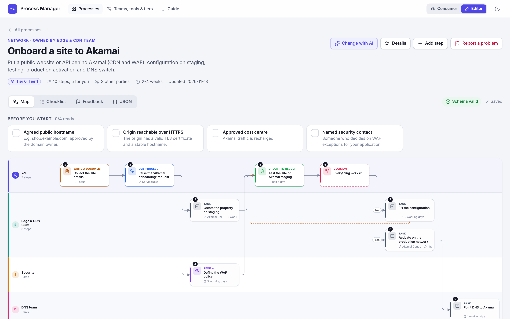
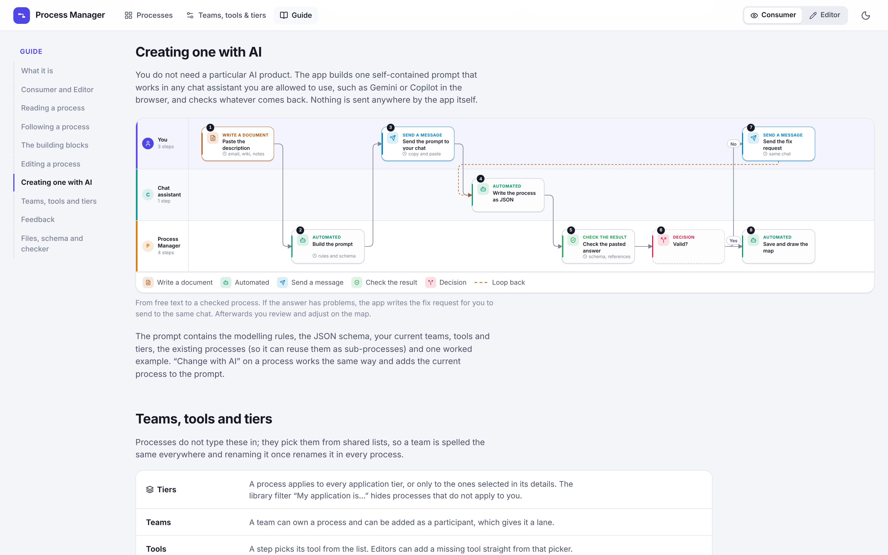

# Process Manager

Capture platform processes (request a GCP project, a repository, Apigee or Akamai onboarding, an Azure landing zone…) once, and read them two ways:

- **Map** – a swim-lane flow. One lane per participant, and **the first lane is always you**.
- **Checklist** – a numbered list that says exactly what to do, with your steps expanded and ticks to track progress.



## Run it locally

```bash
npm install
```

```bash
npm run dev
```

Open http://localhost:5173. Nothing leaves your machine: processes are plain JSON files in `processes/`, written by the app through a small local API in `vite.config.ts`. Commit them to git like any other file.

## Consumer and Editor

The switch in the top bar changes what the app offers:

- **Consumer** – find a process, read the map, follow the checklist, look up teams and tools, flag what does not work.
- **Editor** – everything above plus creating and changing processes, the JSON tab, the schema check, managing teams, tools and tiers, and closing feedback.

It is a view, not a permission: anyone can flip it, and the choice is remembered in the browser.

## Guide

The app has a built-in **Guide** (top bar) that explains every feature, with flow charts for following a process, creating one with AI, and the feedback loop. The charts are themselves processes, drawn by the same map.



## How a process is described

| Concept | Meaning |
| --- | --- |
| **Owner and tiers** | `owner` is a team from the catalog. `tiers` limits the process to some application tiers (e.g. Tier 0 and Tier 1); leave it out and it applies to all. |
| **Prerequisites** | What must be in place before step 1. Can point to another process that produces it. |
| **Actors** | Who takes part. Each is a lane. `actors[0]` is always `me`. |
| **Steps** | One action by one actor, with a block type, exact instructions, tool, link, duration and outcome. |
| **Block types** | `form`, `code`, `approval`, `review`, `wait`, `communication`, `meeting`, `automation`, `document`, `verify`, `decision`, `subprocess`, `task` – each has its own icon and colour. |
| **Flow** | `next` on every step. Decisions have labelled branches; loops (reject → fix → resubmit) are drawn dashed. |
| **Sub-processes** | A step can set `subProcessId` to delegate to another process (e.g. “Raise a ServiceNow request”). |

The format is defined by [`schema/process.schema.json`](schema/process.schema.json) (JSON Schema 2020-12).

## Teams, tools and tiers

Processes pick their owner, participants, tools and tiers from shared lists in `catalog/catalog.json` (schema: `schema/catalog.schema.json`). Manage them on the **Teams, tools & tiers** page (Editor mode): pick a list, select an entry, edit it on the right, and see which processes use it. In Consumer mode the same page is a read-only directory. A tool can also be added on the spot from the tool picker of a step. An entry that is still used by a process cannot be removed.

## Feedback

Anyone can flag a step (or the whole process) that does not work: *This step doesn’t work* in the step panel, the flag icon in the checklist, or *Report a problem*. Pick a kind, write a sentence, send. Open feedback shows as a red flag on the map and on the library card; the **Feedback** tab lists everything and lets the owner mark items as fixed. Feedback is stored in `feedback/<process-id>.json`, separate from the process itself.

## Editing

Switch to **Editor** first.

- **On the map** – press **+** on an arrow to insert a step exactly there, or **+** on a block to add one after it (on a decision: a new branch). A small form on the map asks what happens, who does it and what kind of step it is. Drag a block to another lane to change who does it.
- **In the side panel** – click a block → *Edit step* for instructions, tool, link and what comes next. *Details* edits the name, owner, tiers, participants and prerequisites. Changes stay in a draft until you press **Save changes**.
- **JSON tab** – edit the raw JSON with live checking.
- **With AI, any chat assistant** – *Create from text with AI* / *Change with AI*:
  1. paste the description (or the change you want),
  2. copy the generated prompt into Gemini / Copilot / ChatGPT / Claude,
  3. paste the answer back. The checker validates it and, if something is wrong, gives you a *fix request* to send to the same chat.
- **With an AI coding assistant** – edit files in `processes/` directly and run the checker. Two Claude Code skills in `.claude/skills/` describe how: `edit-process` (create or change a process) and `manage-catalog` (add or change teams, tools and tiers).

The prompt is also available as a file for sharing: [`docs/llm-prompt.md`](docs/llm-prompt.md) (regenerate with `npm run prompt`). Append the process description at the bottom.

## Schema checker

```bash
npm run validate
```

Checks `catalog/catalog.json` and every file in `processes/` (or the files you pass as arguments) against the JSON schema **and** the rules a schema cannot express: unknown actors, step ids, teams, tools or tiers, duplicate ids, decisions without labelled branches, missing sub-processes, unreachable steps, processes that never end. Exits non-zero on errors, so it can run in CI. The same checker runs inside the app.

## Layout

```
processes/            one JSON file per process (the data)
catalog/catalog.json  teams, tools and application tiers
feedback/             one JSON file per process with user feedback
schema/               JSON schemas + the example used in the LLM prompt
.claude/skills/       instructions for AI coding assistants
src/lib/validate.ts   schema + semantic checker (shared by app and CLI)
src/lib/prompt.ts     prompt builder for browser LLMs
src/lib/layout.ts     swim-lane layout and edge routing
src/components/       map, checklist, step editor, AI dialog, catalog, guide
src/guide/flows.ts    the flow charts shown in the guide
scripts/              validate + prompt CLI
```

> The six sample processes are illustrative placeholders (links point to `example.com`). Replace them with your real ones.
