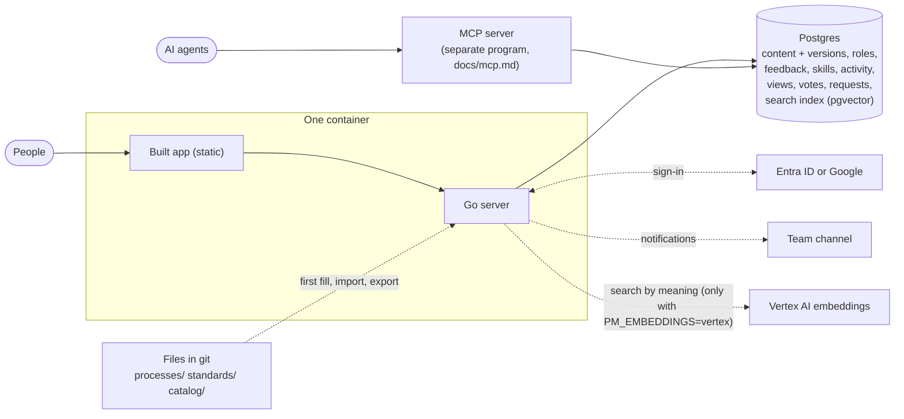

# Backend

Everything people change in the portal is stored in a database: processes, standards, the lists, roles, feedback, requests and the generated skills, and how processes and standards are used (views, bookmarks, upvotes, skill downloads). The server signs people in, enforces their rights, keeps every version, and regenerates skills when their source changes.



## What the server does

| Area | Behaviour |
| --- | --- |
| Sign-in | OpenID Connect with **Entra ID** or **Google**, chosen by `PM_AUTH`. Locally, `PM_AUTH=dev` shows a user picker instead; the server only starts that way on an address of the local machine. The server sets a signed, HTTP-only session cookie (12 hours); the browser never sees a token. The cookie's signed payload carries a random `sid` (18 bytes) that names this one session, so that what the server keeps for a session (viewing as somebody else) belongs to it alone; a cookie from before `sid` is named by when it was issued. |
| Viewing as somebody else | An admin can see the portal as another person sees it, in one session, read only, for at most an hour. See [Viewing as somebody else](#viewing-as-somebody-else). |
| Sign-out | Ends every session of that person, on every device: a copy of the cookie stops working too, and a copy that was ended cannot sign the person out again. If the database cannot say whether a session was ended, the answer is `503`, neither "signed in" nor "signed out"; a sign-out during such an outage clears the cookie of that browser and says that the other sessions could not be ended. |
| Roles | Identity (name, email) comes from the provider. Roles are stored in the database and managed in the Admin panel. They are read on every request, so a change applies at once. |
| Content | Processes, standards and the lists (one document) are JSON documents in the database. Every save is a new **version** with who saved it, when, and an optional note; a version that publishes changes somebody else saved last also keeps who that was (`changesBy`, migration 012); a delete is recorded too. Saving an unchanged document creates no version. |
| Saving at the same time | A save says which version it was made from (`?base=`). If that is no longer the current one, nothing is stored and the answer is `409` with who saved in between. `base=0` means "I am creating this" and is refused when the document exists. Changes to one document, including creating it, run one after the other. Without `base` (imports, scripts) there is no such check. |
| Never published | A document with status `draft` (it was never published, or was taken back from readers) is only sent to the people who may edit it, to the members of its platform or practice and to the owner role of the team that owns it (`rbac.Perms.CanSeeDraft`). For everyone else it does not exist: not in the lists, not in the history, feedback on it is neither listed nor accepted, and deleting it answers "does not exist". Versions that were drafts stay hidden from readers after publication, in the list of versions too. Skills are for everyone, so a skill names a draft it refers to by its id, never by its title; the refusal to remove a list entry names only documents the caller may see and counts the rest. |
| Working drafts | Changes that are not stored as the document itself are kept beside it as one **working draft** per process or standard, shared by everyone who may work on its drafts (whoever may edit it, and the members of its platform or practice). For a **published** document (active or retired) they are its unpublished changes, until somebody publishes or discards them. For a **never-published** document (`status: "draft"`) they are what cannot be stored as the document yet (something still to fix): "Save draft" always works, and the next save that passes every check stores the work as the document and removes the working draft in one step (`PUT …?draft=R`). Readers, the lists, the history, skills, search by meaning, the statistics and the MCP server never see a working draft, and nothing says that one exists: for everybody who may not work on the drafts of the document every call about it answers like something that does not exist. Saving a working draft makes no version and is not in the activity log; publishing it is an ordinary save (the same checks, a new version with its note, skills and the search index follow), and every discard is logged. See [Working drafts](#working-drafts). |
| Validation | Every save is checked against `schema/*.schema.json` (the same files the app uses), and then for what a schema cannot express: steps that point to steps that exist, participants that exist, the answers of a decision (in the app's words: "This decision needs at least two answers that lead somewhere.", "Every answer of a decision needs a name, such as Approved or Rejected.", "Another answer already leads to this step: let each lead somewhere else."), no duplicate ids (also within each list), tiers, paths, architecture patterns, environments, languages, and the category, practice and platform of a process or standard, that are in the lists (`paths[0]: "x" is not a known path. Known paths: …`, which the app turns into its own sentence), and a review date that is a real day (`server/internal/docs/check.go`). These are the rules the app's checker treats as errors; what it only warns about (an owner that is not in the lists yet, a process that is not described yet) is accepted. An entry of the lists that a process, a standard or a role still uses cannot be removed: a category, practice, platform or path that something belongs to or names, a team that owns something or takes part in a step, and a team, platform or practice that a role (an owner or a member) is limited to. The lists' own check also refuses an other name of a path that another path also has or that is another path's name ("The paths “Paved path” and “Lift” are both also called “Golden Path”: keep it on one of them.", "The path “Lift” is also called “brownfield”, which is the name of the path “Brownfield”: take it off “Lift”."), a link of a team, platform or practice that is not `http://` or `https://` ("The page link of the platform “P” is not a whole link: write it with https:// at the start.", with "remove the spaces and" before "write" when it has spaces), one longer than 300 characters ("Shorten the …"), a group email that is not one ("The group email of the platform “P” is not an email address: write one, like team@company.com.") and two entries of one list with the same id ("Two tools have the id “terraform” (“Terraform” and “Terraform Cloud”): remove one of them."). These sentences are the app's own for the same problem (`issueText` with `"lists"` in `src/lib/editing.ts`); an entry is named by its name, else by its id ("the platform with the id “p”"), never by its place (`docs.EntryWords`). The app turns a refusal of the lists - the format's problems by path as well as these sentences - back into its own words (`refusalIssues` in `src/lib/validate.ts`). A list that is missing from the lists counts as empty. |
| Skills | After a save or delete, the skills of that process or standard are regenerated from what is stored, and so are the skills of every document that names it. A new version is stored only when the text changed; it records the version of its source. A pointer to the skill of another document is only written when that document is active. A skill names the owning team and, when they are set, the category, practice and platform (by name, each team, platform and practice with how to reach it, in a fixed order: "Platform: Google Cloud (Group email: …; Slack: #cloud-platform (https://…); Confluence: …; Request form: …; Other: …)") and, for a process, its rigour in plain words. Changing the lists regenerates everything, because names appear in the text. Regeneration runs one at a time and does not depend on the browser that saved staying connected; the answer to the save waits for it for up to 20 seconds, after which it finishes on its own. |
| Feedback | About a step of a process or a requirement of a standard. Anyone signed in can report and say "I hit this too". The text is checked like the text of a request (line breaks allowed): "The text contains control characters. Remove them and try again.", "The text contains characters that change the reading direction. Remove them and try again.", "The text has no visible characters." |
| Stale feedback | Each item remembers a fingerprint of the step or requirement it was written about. When that changes or disappears, the item is flagged "may already be fixed". |
| Search by meaning | Off unless `PM_EMBEDDINGS` is set. Published processes and standards are cut into parts, each part is turned into a vector, and `GET /api/search` finds the parts closest in meaning to a question and returns their documents. See [Search by meaning](#search-by-meaning). |
| Notifications | New feedback is announced to the owning team (its name and everything the lists say about how to reach it, in the order of the skills: "Group email: …; Slack: #cloud-platform (https://…)"; also for feedback on a draft); a fix is announced to the reporter. `PM_NOTIFY=log` writes them to the server log, `webhook` posts `{"text": …}` plus the event fields (`type`, `targetKind`, `processId`, `processTitle`, `stepTitle`, …) to a URL (a Slack incoming webhook accepts this as is). The webhook is called in the background, up to three times, and what people typed is escaped so that it cannot become chat markup. A brake keeps one person at about 30 stored items an hour; it is a courtesy limit against a script gone wrong, not a hard quota. |
| Views | Opening a process or standard counts a view (`POST /api/views/…`), at most once per person, document and day (the server's date in UTC). The server stores who viewed what on which day only to count views and different people ("people"); nobody is ever shown who viewed something. The all-time views, people and downloads of each document are kept in `document_counts`, updated in the transaction that records a view or download, so reading them does not depend on how many were ever recorded. A failure to count is logged and the page is answered with the numbers as they are. |
| Bookmarks and upvotes | Anyone signed in can bookmark a process or standard (kept per person on the server, so it follows them to another device) and upvote it ("this is useful"): one vote per person, which can be taken back. |
| Skill downloads | A download of a skill or review agent from the portal counts for the process or standard it comes from, at most once per person, skill and day (like views): downloading the same file fifty times in a day is one download. Who downloaded is stored for that alone and never shown. `-export` has no person and counts one per skill it writes on every run, so an export that is scheduled adds one per skill per run. Only the download of the latest text counts: reading an older version in the app is not a download. Downloads stored before the person was kept have no person and count as they were. Nothing is counted for a skill whose document no longer exists. A failure to count is logged and never stops the download. |
| Counts and drafts | Counts, bookmarks and upvotes are only given for what the caller may see: a draft somebody cannot see answers `404` and is left out of every count and list. Which documents are drafts, and what they belong to, is read from columns the database keeps of every body (`status`, `owner`, `platform`, `practice`), so no body is read for it. Admins see everything in the statistics, drafts included, marked by their status. |
| Deleting a document | Its feedback, bookmarks, upvotes and kept numbers are deleted with it. Its views and downloads stay, so that the totals and the trend of a past period do not change, but they are marked as belonging to a deleted document (their id becomes `<id>@deleted-<n>`): they count for no document, and something new created under the same id starts from nothing. A done request it answered stays done, loses the link and says that its answer was removed (`linkedGone`). |
| Requests | Anyone signed in can ask for a process or standard that does not exist yet: a title (5-120 characters), what is needed and why (10-1000), and optionally the platform and practice it would belong to (they must be in the lists). Surrounding white space is trimmed before the length is measured; control characters (a line break is fine in the description and the note), characters that change the reading direction and text without a visible character are refused. Everyone sees all requests and can vote for them, one vote per person (the requester too). A request is `open`, `planned`, `done` (linked to a published process or standard of the same kind that answers it) or `declined` (with a reason); it can be set back to open. A brake keeps one person at 10 requests an hour: the count and the new request are stored in one step per person, so requests sent at the same time cannot slip past, and requests withdrawn or removed in the hour still count. Creating, changing the state and deleting are written to the activity log in plain words, e.g. "“Naming of cloud resources”: Done, answered by the standard “Naming”". |
| Statistics | For admins: per process and standard, the views, people, skill downloads, upvotes and handled feedback of a period, with the upvotes and open feedback as of now; totals, with the part that belongs to deleted documents; the same grouped by platform, practice and owning team; views, people and downloads per week; and the same rows as a CSV file. See [Statistics](#statistics). |
| Reviews | The team that owns a process or standard is asked to confirm regularly that it is still correct. The owner role of that team can record that without being an editor (`POST …/review`): it is the one change to content that role may make. Whoever may edit it can record it too. A confirmation is recorded on the published document also while it has unpublished changes, and moves a working draft based on the reviewed version onto the new one; publishing the draft afterwards keeps the confirmation (see [Working drafts](#working-drafts)). A document never reviewed has its first review counted from when it was first published (`meta[id].publishedAt`), in the app (`reviewOf` in `src/lib/lifecycle.ts`) and in the MCP server alike: "First review due …", then due a month before and overdue after, like every later review. **Days.** The app counts in the reader's own day (`today` / `dayOf` in `src/lib/dates.ts`): today, the day of `publishedAt`, and the day a save stamps as `updatedAt`. A day stored in a document (`review.lastReviewedAt`, `updatedAt`) is a calendar day and is never shifted. The review call takes the person's day (`?day=`, below). The MCP server (`reviewOf` in `server/internal/mcpserver`) and `npm run reviews` have no reader and count in UTC days, so near midnight a review can turn due a day earlier or later for an agent than for a reader far from UTC. Views, downloads and the statistics are cut in UTC days as well (see [Statistics](#statistics)). |
| Activity | Every change to content (with the version and its note, including publishing - the first publication of a document is `process.publish` / `standard.publish` whichever call made it - and every discard of a working draft, also one that a save or a publish removed without making a version), lists (also a change of one group's details, as `lists.save` with "version 3: Details of the team “Cloud Platform team” changed by Casey Owner: description, Slack channel", naming only what changed), icons, roles (also the members of a platform or practice added or removed on its page, as `access.grant` / `access.revoke` with "Platform member for the platform Google Cloud"), skill guidance and the look of the portal (`theme.change`) is recorded with who and when, and so is every request made, changed in state or deleted. For processes, standards and the lists the entry is written in the same transaction as the change; for roles, skill guidance, feedback and requests it is written right after it, and a failure to write it is logged. Views, bookmarks, upvotes and votes are not recorded. Closing, reopening or deleting somebody else's feedback is recorded too. |
| Look of the portal | The default look is the designer's palette in Roboto. An admin sets the portal's name, logo, brand colour, second colour, ink, the colours of processes and of standards, of the main and the other buttons, of the four states (success, warning, information, problem), the highlight and the quiet surface, the font, and whether people who have not chosen light or dark themselves get the light, the dark or the device's look (Admin › Theming). Only what the admin chose is stored, in `portal_settings` (key `theme`); the readable variants of the colours for light and dark, the ink on filled parts and the warnings are worked out by the app (`src/lib/theme.ts`). Everyone, also before signing in, reads it with `GET /api/theme`, and the logo with `GET /api/theme/logo`; who changed it last is told to admins only. See [Look of the portal](#look-of-the-portal). |
| Protection | Every change needs the header `X-Requested-With: process-manager` (stops cross-site form posts), bodies are limited to 1 MB, ids are validated, a request gets 30 seconds. Every answer carries a content security policy (only the app's own scripts, no `eval`, no framing), `X-Content-Type-Options`, `X-Frame-Options`, `Referrer-Policy`, and `Strict-Transport-Security` when the address is https. |
| Operation | Requests to `/api` and `/auth` are logged with status and duration (`PM_LOG_FORMAT=json` for one JSON object per line). `/healthz` says the process runs, `/readyz` that it also reaches the database. On SIGTERM the server stops accepting requests and finishes the ones in progress (up to 15 seconds) before it closes the database. |

### Roles

| Role | May | Scope |
| --- | --- | --- |
| *(everyone signed in)* | Read published content and its versions, see who belongs to which team, platform and practice, tick steps, report, "I hit this too", delete own feedback, read and download skills, bookmark and upvote, request a process or standard, vote for requests, withdraw own requests while they are open | |
| `owner` | Confirm reviews; mark fixed / reopen / delete feedback; see drafts that were never published; change the team's description and how to reach it | Required: one team; applies to what that team owns |
| `platform-owner` | Create, change, publish and delete the processes and standards that belong to the platform, including drafts; confirm their reviews; manage their feedback; edit the guidance of their skills; add and remove the platform's members; change its description and how to reach it | Required: one platform; applies to what names it as its platform |
| `practice-owner` | The same for what belongs to the practice | Required: one practice; applies to what names it as its practice |
| `platform-member` | See the drafts of what belongs to the platform; create drafts there; save, read and discard working drafts. Never publish, retire, unpublish, bring back or delete, confirm reviews, manage feedback, edit skill guidance, change the lists or give roles | Required: one platform |
| `practice-member` | The same for what belongs to the practice | Required: one practice |
| `process-editor` | Create, change and delete every process, including drafts; manage their feedback; edit the guidance of their skills | All processes |
| `standards-editor` | The same for every standard | All standards; it cannot be limited |
| `catalog-manager` | Change the lists; upload icons for them | |
| `admin` | Everything, including roles, the activity log, the system page and the statistics; removing any request; viewing the portal as somebody else (read only) | |

A process or standard belongs to a team (`owner`), and may belong to a platform (`platform`) and a practice (`practice`), as its content says.

- **May edit** (`CanEdit`: everything readers would see - a plain save of a published document, a save with a status other than `draft`, `POST …/publish`, retiring, unpublishing, bringing back, deleting; and everything below): admins; process editors for a process; standards editors for a standard; the owners of its platform; the owners of its practice.
- **May draft** (`CanDraft`: a save that stays a draft - the stored and the new status both `draft`, also `?draft=R` - and `GET`/`PUT`/`DELETE …/draft`; creating a document as a draft): whoever may edit it, and the members of its platform or practice (`platform-member`, `practice-member`). Anything readers would see needs the edit right: a member gets `403` with who can, in words that follow what the save would do - "Only an owner of the platform “Google Cloud”, or a process editor, can publish this process. Your draft is saved for them." (`?draft=R` and `POST …/publish`), "… can publish this process. Save it as a draft for them." (a plain save of a never-published one), "… can change this process as readers see it. Save your changes as a draft for them." (a plain save of a published one), "… can retire this process.", "… can bring back this process.", "… can hide this process from readers.", "… can delete this process." (a standard: "a standards editor", "this standard"). Whoever may not see the document gets the answers of an id that does not exist, as before.
- **May confirm reviews and manage feedback:** whoever may edit it, and the `owner` role of its team. A team's owners do not edit; members of a platform or practice do neither.
- **May see a never-published document** (`CanSeeDraft`): whoever may manage its feedback, and the members of its platform or practice - in the lists, the history and single versions, feedback, the counts and views, and the check of a request's link. Working drafts (of a published or a never-published document) and `meta[id].draft` only for whoever may draft it, not the owner role of its team. Search, skills and the MCP server never show a draft.
- **The first publication** (a plain save, `?draft=R` or `POST …/publish` that makes a never-published document visible, and creating one published) needs the right for its whole placement, as a new document: an owner of every platform and practice it names, or an editor of the kind. On a platform and a practice: "Only somebody who owns both the platform “Google Cloud” and the practice “Cyber security”, or a process editor, can publish this process. Your draft is saved for them." Publishing the unpublished changes of a published document needs an owner of either of its stored places; a move is checked against the publisher's owner rights (below).
- A save needs the right for the stored version and for the new content, checked in the same transaction as the save. So an owner of one platform cannot take over a document of another platform, and cannot move one of theirs to a platform or practice they do not own, or to none. Creating needs the right for the new content: a platform owner can create what belongs to their platform, a platform member a draft there. A member who saves elsewhere gets "You can only save a draft of a process that belongs to a platform or practice you are a member of." ("… you own or are a member of." for somebody who is both).
- **Shared documents:** somebody who may edit a document only as an owner of its platform or practice may put it on a platform, or take it off one, only when they own that platform: both the one it had and the one it gets (`rbac.Misplaced`). For a save that stays a draft the platforms and practices they are a member of count as well (`rbac.MisplacedDraft`), with "Only an owner or member of the platform “Azure”, or a process editor, can put this process on that platform or take it off it." The same holds, separately, for the practice. An owner of only the practice of a document that is also on a platform therefore cannot change, add or remove its platform, and the reverse; when creating, every platform and practice set must be theirs. Everything else, the owning team included, they may change. Admins, process editors (for processes) and standards editors (for standards) are not limited. This is checked under the same lock as the save, so it holds for putting an older version back and for creating something under the id of a deleted document too. The refusal is `403` "Only an owner of the platform “Azure”, or a process editor, can put this process on that platform or take it off it." (for a practice: "… can put this standard in that practice or take it out of it.", with "a standards editor" for a standard).
- A role that covers everything (`admin`, `catalog-manager`, `process-editor`, `standards-editor`) gives nothing when it carries a scope; only an earlier version could store one. The Admin panel lists it so that it can be removed.
- `PM_ADMINS` names the bootstrap admins. They are always admin and cannot be removed in the panel.
- Without bootstrap admins, the last admin in the database cannot be removed (409).
- The scope of `owner` must be a team in the lists, of `platform-owner` and `platform-member` a platform, of `practice-owner` and `practice-member` a practice. A team, a platform and a practice may share an id; each role looks in its own list.
- The owners of a team, platform or practice are the people with `owner`, `platform-owner` or `practice-owner` limited to it; the members of a platform or practice those with `platform-member` or `practice-member`. A team has no members. There is no separate membership: the Owners and Members sections in Admin › Lists give and take these roles through `/api/admin/access`, Admin › Access through `/api/admin/users`, the page of a platform or practice its members through `/api/groups/…/members` (an admin, or an owner of that platform or practice), and everyone signed in can read them through `/api/members`. Owners are given and taken by admins only. Membership is not read from Entra or Google groups. One person can be in a team, a platform and a practice at the same time, and both owner and member of one; the stronger wins.
- An address with control or invisible formatting characters (a zero-width space, a change of reading direction) is refused wherever a role is given: `400` "That is not an email address." An address stored by an earlier version can still be removed.
- A team, platform or practice that a role is still limited to cannot be removed from the lists; the roles have to be taken away first: "cannot remove what is still in use: 2 people are still owners or members of “aws”. Take their roles first, then it can be removed." (with documents that use it: "… “security” is still used by “Secure logging”, and 2 people are still its owners or members. Change those first and take their roles, then it can be removed."; a team: "Owners").
- If the roles cannot be read, the request is treated as a reader's (no role).
- **Requests:** the state of a request is changed by whoever could create what it asks for: admins; process editors for a process request; standards editors for a standard request; the owners of the platform and of the practice it names. A team's owners and the members of a platform or practice do not. The requester may withdraw (delete) their own request while it is open; an admin may delete any request. Marking one done needs a published process or standard of the same kind: one that every reader can see. A draft is refused ("Only a published process can answer a request. Publish it first."); a retired one is accepted, because it is still there to read. If the answering document becomes a draft again later, people who cannot see it get `linkedId` `""` and `linkedGone` `false`, and nothing else of it. If it is deleted, the request stays done with `linkedId` `""` and `linkedGone` `true` for everyone, and a document created later under the same id does not become the answer.
- A platform or practice that a request names can still be removed from the lists: a request is a wish, not part of the structure. The request keeps the id, and the app shows the id where it would show the name. Nobody is then its platform or practice owner; admins and the editors of the kind still manage it.

## API

All under the same origin as the app. JSON in and out; errors are `{"error": "…"}`.

| Method and path | Purpose | Who |
| --- | --- | --- |
| `GET /api/me` | Who is signed in, their rights, the provider. `perms` is `{admin, catalog, processes, standards, owns, platforms, practices, memberPlatforms, memberPractices}`: `owns`, `platforms` and `practices` are the team, platform and practice ids the person owns, `memberPlatforms` and `memberPractices` those they are a member of (sorted; empty lists, never null), filled from the person's roles whether or not they are an admin; for an admin `catalog`, `processes` and `standards` are always `true`. `search` is `{"meaning": true\|false, "outside": true\|false, "provider": "builtin"\|"vertex"}`: whether search by meaning is switched on, whether the text of a search is sent to an outside service (Vertex AI), and which provider (left out when off; the page explains Meaning after it). While an admin views the portal as somebody else, `user` and `perms` are that person's, and `viewedBy` is `{"email", "name", "until"}` (the admin, and when it ends, RFC 3339 UTC); otherwise there is no `viewedBy` | anyone |
| `GET /auth/login`, `GET /auth/callback` | Sign-in with Entra ID or Google | anyone |
| `POST /auth/dev/login` | Local development only: `{"email": "sam@example.com"}` | anyone |
| `POST /auth/logout` | End every session of the person | signed in |
| `GET /api/processes`, `GET /api/standards` | `{"processes": […], "meta": {id: {version, updatedAt, updatedBy, updatedByName?, createdAt, publishedAt?, draft?}}}` (or `standards`); drafts only for those who may see them. `updatedByName` is the name of whoever stored the version last, where the portal knows it (from the same sources as Admin › Access; left out otherwise). `createdAt` is when the document was added: when its first version was saved (for an id that was deleted and created again, the first version since). `publishedAt` is when readers could first see it: the time of its first stored version, since the last deletion, whose status is not `draft` (`docs.Store.Published`); left out for a document never published. The first review is counted from it. `draft` is `{updatedAt, updatedBy, updatedByName?}` of its working draft (unpublished changes, or the newer changes of a never-published document; `updatedByName` left out when unknown), only when there is one and only for those who may work on its drafts (edit it, or be a member of its platform or practice) - the owner role of the team that owns a never-published document sees the document, not its `draft`. | signed in |
| `GET /api/catalog` | The lists (tiers, paths, environments, languages, teams, tribes, domains, practices, platforms, categories, tools, architecture patterns `patterns`); a team may name its `tribe`, a tribe its `domain`; lists stored without `patterns`, `tribes` or `domains` have none, and nothing adds them; their version is in the header `X-Document-Version` | signed in |
| `GET /api/search?q=&limit=` | Search by meaning: `{"results": [{"kind", "id", "score", "hits": [{"part", "item", "label", "snippet", "score"}]}], "truncated": false}`, best first, at most `limit` documents (1-500, default 50; anything else `400` "Ask for 1 to 500 results."). `truncated` is `true` when more documents matched than were returned; the page then says "Showing the N closest…" and its filter counts read "N+". Only published documents (active and retired), never a draft, also not for those who may see it. `score` is 0 to 1, higher is closer; a document's score is that of its best part; up to 3 hits each, best first. `part` is `summary`, `step`, `prerequisite`, `requirement` or `scope`; `item` the step or requirement id (`""` for summary and scope, the position `"0"`, `"1"`… for a prerequisite). An empty `q` gives `{"results": []}`; one longer than 1000 characters `400`. `404` "Search by meaning is not switched on." when it is off; `429` "You have searched very often in the last minute. Wait a moment, then try again." after 60 searches of one person in a minute; `502` "Search by meaning is not available right now. Try again in a moment, or search by words." when the provider cannot be reached; `503` "Search by meaning is not ready yet. Try again in a moment, or search by words." while the index is being built or switched to new settings, when it is marked as not in use, or when it was built with other settings than this server's. The page applies its filters, counts and paging itself. | signed in |
| `GET /api/members` | `{"members": [{"email", "role", "scope", "name"?}]}`: every assignment of `owner`, `platform-owner`, `practice-owner`, `platform-member` and `practice-member`, sorted by role, scope and email; `name` where the portal knows it (from the activity log, feedback and requests; in development the built-in users). Never who gave the role or when | signed in |
| `POST /api/groups/{platforms\|practices}/{id}/members` | `{"email"}`: makes the person a member (`platform-member` / `practice-member`) of that platform or practice. Answers `200` `{"members": [{"email", "role", "scope", "name"?}], "note"?}`: the group's owners and members. Somebody who is already a member or an owner of it: `200` unchanged, with the note "pat@example.com is already a member of the platform “Google Cloud”: nothing changed." (or "an owner"). `400` "That is not an email address." (also for control or invisible characters); `403` "Only an owner of the platform “Google Cloud”, or an admin, can add or remove its members."; `404` "There is no platform “nope” in the lists." (`teams`: "That does not exist."); `413` "The request is too large.". Logged as `access.grant` with "Platform member for the platform Google Cloud". | admins, owners of that platform or practice |
| `DELETE /api/groups/{platforms\|practices}/{id}/members?email=` | Removes the person's member role for it; the same answers. Somebody who is not a member: `200` with the note "… is not a member of the platform “Google Cloud”: nothing changed." An address stored by an earlier version can always be removed. Logged as `access.revoke`. | the same |
| `PUT /api/groups/{teams\|platforms\|practices}/{id}/details` | `{"description"?, "contact"?, "contacts"?}`: changes only these fields of that one entry of the lists; a field left out stays, `null` or `""` removes it, `contacts` replaces all the ways to reach them (an empty object removes it). Applied to the newest stored lists and saved through `docs.Store.Save` as a new version of the lists, with every check a save of the lists gets (tried again when somebody saved the lists at the same moment; `409` "The lists are being changed by others right now. Try again in a moment." after 10 tries); Admin › Lists meets it as somebody else's save. Answers `200` `{"catalog": <the lists as stored>, "version": N}` and `X-Document-Version`. A call that changes nothing stores nothing (no version, no activity entry) and answers the same. Refusals: `403` "Only an owner of the platform “Google Cloud”, a lists manager or an admin can change its details." ("Only an Owner of the team …"); `400` "Only the description and how to reach them can be changed here.", "Say what to change: the description, the contact or how to reach them.", "Their page must be a link that starts with http:// or https://." (also "The request form …", "The link to the Slack channel …", "The link to the Google Chat space …", "The Confluence page …"), "The group email is not an email address.", "There is no way to reach them called “phone”. Use email, slack, slackUrl, chat, chatUrl, confluence, page or form.", "The description is 601 characters long; it can be at most 600." (the free line at most 120); `404` "There is no platform “x” in the lists.". The version's note and the activity entry (`lists.save`) name the group, the person and only what changed, by label: "version 2: Details of the platform “Google Cloud” changed by Jordan Platform: Google Chat space, Their page" (labels: description, Group email, Slack channel, Slack channel link, Google Chat space, Google Chat space link, Confluence page, Their page, Request form, other ways to reach them). | admins, lists managers, owners of that team, platform or practice |
| `PUT /api/processes/{id}?base=&note=&draft=`, `DELETE /api/processes/{id}?base=` | Save or delete a process. Answers `{ok, changed, version, updatedAt, updatedBy}`. A version conflict is `409` with `{"error": "Alex Editor saved a newer version (version 2) while you were working on this.", "conflict": {exists: true, version, status, updatedAt, updatedBy, updatedByName?}}` (the name where the portal knows it, else the email); a document deleted meanwhile is `409` `{"error": "This was deleted by someone else while you were working on it.", "conflict": {exists: false}}`, which names who deleted it - "Dana Admin deleted this process while you were working on it.", with `deletedBy`, `deletedByName?` and `deletedAt` in `conflict` - only when `base` is a version of exactly what was deleted, the document does not exist now and the caller could edit its last version (`docs.Store.LastDeleted`). A save that stays a draft (the stored and the new status both `draft`) needs the right to draft; anything readers would see needs the right to edit (see [Roles](#roles) for the refusals a member gets). A version that publishes a never-published document saved last by somebody else records them (`changesBy`). While the process has a working draft an ordinary save is refused: for a published one `409` with `{"error", "draft": {updatedAt, updatedBy, updatedByName?}}` and no `conflict`: "This process has unpublished changes by … . Publish or discard them before you hide the process from readers again." (to `draft`), "… before you retire the process." (to `deprecated`), otherwise "… Publish or discard them first, then make this change."; for a never-published one `409` in the shape of a draft conflict ("… saved newer changes to this draft while you were working on it.", `conflict` with `draft: true` and the revision as `version`, plus `draft`). **`draft=R`** (never-published documents only) stores the body as the document in place of its working draft of revision R; see [Working drafts](#working-drafts). A document readers do not see (`status: "draft"`, stored) cannot be saved as `deprecated`: `400` "A process that readers do not see cannot be retired. Publish it first, or delete it." A save that makes a document readers did not see published (a status other than `draft`) is logged as `process.publish`. Deleting deletes the working draft too. A save that is not allowed is `403`: "You can only save a process that belongs to a platform or practice you own." for a platform or practice owner whose new content is not theirs ("… you own or are a member of." for somebody who is also a member, "You can only save a draft of a process that belongs to a platform or practice you are a member of." for a member), otherwise "Only process editors and the owners of its platform or practice can change this process." To somebody who may not see a never-published process, a save answers exactly as for an id that does not exist: with `base` above 0 or `draft=`, the plain deleted conflict (no name); with `base=0` or without `base`, `409` "Something else already has this id. Give the process another name." Somebody who sees it but may not edit it (the owner role of its team) gets the `403`. | process editors, owners of its platform or practice; members of it for a save that stays a draft |
| `PUT /api/standards/{id}?base=&note=`, `DELETE /api/standards/{id}?base=` | The same for a standard | standards editors, owners of its platform or practice; members for a draft |
| `POST /api/processes/{id}/review?base=&day=`, `POST /api/standards/{id}/review?base=&day=` | Record that it was reviewed and is still correct: the date and the caller's name. `day` (`YYYY-MM-DD`) is the person's own today, which the app sends; it is used while it is today somewhere on Earth (from the day at UTC-12 to the day at UTC+14, `docs.TodaySomewhere`). Missing, not a real day or outside that window (an older app, a script, a computer whose clock is wrong), the server's UTC day is used instead: the review is never refused for its day. The date never moves back: when the stored `lastReviewedAt` is later (somebody ahead of UTC confirmed first), it stays (`docs.WithReview`). It is saved as a version with the note "Reviewed: confirmed as still correct". Nothing else in the document changes. Only for something published and in use: `400` "Only a published process is reviewed. Publish it first." for a draft, "A retired process is not reviewed any more." for a retired one ("standard" for a standard); `409` when `base` is not the current version. A working draft based on the reviewed version is moved onto the new one in the same transaction (its revision and body stay). Answers like a save, plus the `document`. | editors of it, and the owner role of its team |
| `GET /api/processes/{id}/draft`, `GET /api/standards/{id}/draft` | The working draft: `{"doc": {…}, "base": 7, "revision": 3, "updatedBy", "updatedByName"?, "updatedAt"}`. `base` is the version it was started from (or moved onto), `revision` grows with every save of it. `204` without a body (`Cache-Control: no-store`) when somebody who may draft it asks and there is none; `404` "That does not exist." for everybody who may not draft the document, whether there is one or not. | who may draft the document: whoever may edit it, and the members of its platform or practice |
| `PUT /api/processes/{id}/draft?rev=&base=&known=` (and standards) | Body: the whole document. Saves the working draft: `{"revision", "base", "updatedBy", "updatedByName"?, "updatedAt", "document": {version, status, updatedAt, updatedBy, updatedByName?}}`; `document` is the stored document as it is now, so the app can tell the person at once that somebody else retired, unpublished, published or saved it meanwhile. `rev` is required: the revision it was made from, `0` to start one. `known` (optional; the app sends it on every save) is the version of the document the screen knows: when the document was deleted meanwhile and the caller could edit its last version, the answer is the deleted conflict with who deleted it (as for a save), otherwise `404`. See [Working drafts](#working-drafts) for what the body must be, the answers and `base`. | who may draft the document and what the draft makes of it |
| `DELETE /api/processes/{id}/draft?rev=` (and standards) | Discards the working draft: `204`. `409` like a save when `rev` is not its revision or it is gone. In the activity log (`process.discard`): for a published document with who saved the changes last and which version readers keep; for a never-published one "changes kept in its draft, last saved by …; the process stays as stored in version N, which readers do not see". | who may draft the document |
| `POST /api/processes/{id}/publish?rev=&note=&over=` (and standards) | Publishes the working draft as the next version: answers like a save (`{ok, changed, version, updatedAt, updatedBy}`), and the working draft is gone. For a never-published document it makes the document active, which needs the right for its whole placement (see [Roles](#roles)). When somebody else saved the draft last, the version records them (`changesBy`) and the activity entry ends "; the changes were last saved by Morgan Member". A member gets `403` "Only an owner of the platform “Google Cloud”, or a process editor, can publish this process. Your draft is saved for them." See [Working drafts](#working-drafts). | who may edit the document and what the draft makes of it |
| `PUT /api/catalog?base=&note=` | Save the lists. A team, platform or practice may carry `contacts` (see [Teams, platforms and practices](#teams-platforms-and-practices)); an empty `contacts` object is refused, so leave it out. | lists managers |
| `GET /api/history/{process\|standard\|catalog}/{id}` | Versions: `{"versions": [{version, savedAt, savedBy, savedByName?, note, deleted, …}]}`: number, who (`savedBy`, an email, `import` or `system`; `savedByName` the person's name where the portal knows it, from the same sources as Admin › Access), when, note, deleted; `changesBy` / `changesByName` who last saved the changes this version published, when that was somebody other than the publisher (`POST …/publish`, `PUT …?draft=R`, and the first publication of a never-published document by a plain save; absent otherwise, for imports and on versions stored before). Versions older than the most recent deletion of the id belong to the deleted document: they are listed only for admins and the editors of every document of the kind (process editors, standards editors), not for whoever created something new under the id. | who can see the document; admins for deleted ones |
| `GET /api/history/{kind}/{id}/{version}` | The content of one version | as above; a version that was a draft only for those who may see drafts; one from before the most recent deletion only for admins and the editors of the kind |
| `GET /api/feedback` | All feedback as `{process: {id: […]}, standard: {id: […]}}`, as the caller sees it (`mine`, `canManage`, `alsoHitByMe`, `stale`). Feedback on a draft is only for those who may see the draft: it is left out for everybody else, and the calls below on such an item answer `404` "That feedback no longer exists.", also to its author | signed in |
| `POST /api/feedback` | `{"targetKind", "targetId", "itemId"?, "kind", "text"}` | signed in |
| `POST` / `DELETE /api/feedback/{id}/also-hit` | "I hit this too" on / off | signed in, not the author |
| `PATCH /api/feedback/{id}` | `{"resolved": true \| false}` | editors of the target, owners of its team |
| `DELETE /api/feedback/{id}` | Remove an item | as above, and the author |
| `GET /api/engagement` | `{"counts": {"process": {id: {views, people, downloads, upvotes, handled}}, "standard": {…}}, "mine": {"bookmarks": [{kind, id, at}], "upvotes": [{kind, id}]}}`. Counts are all-time, only for what the caller may see; a document with nothing yet is left out (read it as zeros). `handled` is feedback marked as fixed. Bookmarks are newest first. | signed in |
| `POST /api/views/{process\|standard}/{id}` | Count a view, once per person, document and day; answers `{"views": n, "people": n}`, the all-time numbers of the document afterwards. `404` "That does not exist." when the caller may not see it. A failure to store the view is logged and answered with the numbers as they are. | signed in |
| `PUT` / `DELETE /api/bookmarks/{kind}/{id}` | Bookmark or drop: `204`. Putting one needs a document the caller may see (`404` otherwise); dropping always answers `204`. | signed in |
| `PUT` / `DELETE /api/upvotes/{kind}/{id}` | Upvote or take back: `{"upvotes": n}` for the document. Upvoting needs a document the caller may see (`404` otherwise); taking back always works, and answers `204` without the number when the caller cannot see the document (any more) | signed in |
| `GET /api/requests` | `{"requests": [Request]}`, newest first. A Request is `{id, kind, title, description, platform, practice, requestedBy: {name, email}, createdAt, state, stateNote, stateBy, stateAt, linkedId, linkedGone, votes, votedByMe, mine, canManage}`; `platform`, `practice`, `stateNote`, `stateBy` (a name), `stateAt` (RFC 3339) and `linkedId` are `""` when not set; `linkedGone` is `true` when the document that answered a done request was deleted | signed in |
| `POST /api/requests` | `{"kind", "title", "description", "platform"?, "practice"?}` → `201` Request. Refusals are `400`: "Say whether a process or a standard is requested.", "Give the request a title of 5 to 120 characters.", "Describe what is needed and why in 10 to 1000 characters.", "The title contains characters that cannot be stored.", "The title contains control characters. Remove them and try again.", "The title contains characters that change the reading direction. Remove them and try again.", "The title has no visible characters." (the same with "The description"), "There is no platform “x” in the lists." (or practice); `429` "You have made a lot of requests in the last hour. Please try again later." | signed in |
| `PUT` / `DELETE /api/requests/{id}/vote` | Vote or take it back: `{"votes": n}` | signed in |
| `PUT /api/requests/{id}/state` | `{"state", "note"?, "linkedId"?}` → Request. `linkedId` is kept only for `done`. Refusals: `403` "Only admins, process editors and the owners of the platform or practice it names can change the state of this request." ("standards editors" for a standard); `400` "The state must be open, planned, done or declined.", "Say why the request is declined.", "Choose the process that answers this request.", "There is no process “x”.", "Only a published process can answer a request. Publish it first.", "Keep the note under 1000 characters.", and the checks of the text with "The note" | admins, editors of the kind, owners of its platform or practice |
| `DELETE /api/requests/{id}` | `204`. `403` "You can only withdraw your own request."; `409` "This request is no longer open, so it cannot be withdrawn." An unknown request is `404` "That request does not exist." | the requester while it is open; admins |
| `GET /api/skills` | Every skill and review agent with its latest version number. A skill whose process or standard is a draft (never published, or taken back to draft; such a skill is withdrawn, `active: false`) is only for those who may see the draft: it is left out for everybody else, and the four calls below answer `404` "That does not exist.", as for an id never used. A skill of a retired or deleted document is served, not active | signed in |
| `GET /api/skills/{id}` | Text, versions, extra guidance, `canEdit` | signed in |
| `GET /api/skills/{id}/versions/{n}` | The text of an older version | signed in |
| `GET /api/skills/{id}/download` | The latest text as a file (`SKILL.md` or `<id>.md`); counts one download, at most once per person, skill and day; never for a skill whose document is a draft, never for a `HEAD`, never while an admin views the portal as somebody else | signed in |
| `PUT /api/skills/{id}/extra` | `{"extra": "…"}`: hand-written guidance, then regenerate | who may edit the source |
| `GET /api/admin/access` | Assignments, bootstrap admins, the names of the nine roles | admins |
| `POST` / `DELETE /api/admin/access` | `{"email", "role", "scope"}`: give or remove a role, the member roles included. The activity log uses the names of the Admin panel, e.g. "Practice owner for the practice Engineering". Refusals are `400` in plain words, e.g. "A standards editor always covers all standards: it cannot be limited to a team, platform or practice.", "A platform owner needs the platform it is for.", "There is no platform “x” in the lists." | admins |
| `POST /api/admin/view-as` | `{"email"}`: this session views the portal as that person. `200` `{"email", "name", "until"}`. See [Viewing as somebody else](#viewing-as-somebody-else) for the refusals. | admins, by their own roles |
| `DELETE /api/admin/view-as` | Stops viewing in this session: `204`, also when nothing was viewed | signed in |
| `GET /api/admin/people` | `{"people": [{"email", "name", "roles"}]}` (`roles`: `true` when the person has a role or is named in `PM_ADMINS`), sorted by address, at most 2000: the people an admin can choose to view the portal as | admins |
| `GET /api/admin/audit?limit=&before=` | A page of the activity log, newest first: `{"entries", "more"}`. `limit` is 100 by default and at most 499; `before` is the id of the last entry of the page before. | admins |
| `GET /api/admin/system` | Provider, address, counts, and `source`: `true` when this installation can show its source files in Admin › Code map (`PM_SOURCE_DIR` names a git checkout whose files can be listed), else `false` | admins |
| `GET /api/admin/source?path=` | One source file of the portal for Admin › Code map: `200` `{"path", "text", "bytes"}` with `Cache-Control: no-store`. `404` "This installation does not show its source code." when it cannot; every refusal of a path, whatever the reason, is the one `404` "That file cannot be shown."; `429` with `Retry-After` after 300 files of one person in a minute. Not written to the activity log. See [Source files for the code map](#source-files-for-the-code-map) | admins |
| `GET /api/admin/statistics?period=7\|30\|90\|365\|all` | The statistics of a period (default `30`); `400` "Choose a period of 7, 30, 90 or 365 days, or all." See [Statistics](#statistics). | admins |
| `GET /api/admin/statistics.csv?period=…` | The same rows as a CSV file | admins |
| `GET /healthz`, `GET /readyz` | The process runs; it also reaches the database | anyone |
| `POST /api/icons` | Body: the image itself, `Content-Type` `image/png`, `image/jpeg`, `image/webp` or `image/svg+xml`. Stores it and answers `{"id": "<64 hex>", "contentType", "width", "height"}`; the same image again answers the same id. `400` with a plain sentence when it is not one of those kinds or not what it says it is, larger than 64 KB ("The image is larger than 64 KB. Make it smaller and try again."), not square, a picture larger than 512 × 512, a moving (animated) PNG or WebP, or an SVG with more than plain drawing; `429` "You have added a lot of icons in the last hour. Please try again later." with `Retry-After` after 60 uploads of one person in an hour. See [Icons](#icons). | lists managers |
| `GET /api/icons/{id}` | The image, with its stored content type, `Cache-Control: private, max-age=31536000, immutable`, `X-Content-Type-Options: nosniff`, an `ETag` (`304` on `If-None-Match`) and `Content-Security-Policy: default-src 'none'; style-src 'unsafe-inline'; sandbox`. `404` "That does not exist." | signed in |
| `GET /api/theme` | The look of the portal: `{"look": {name?, logo?, brand?, secondary?, ink?, process?, standard?, mainButton?, otherButtons?, success?, warning?, info?, problem?, highlight?, quiet?, font?, appearance?}, "revision": n}`; `{"look": {}, "revision": 0}` while nobody changed it. Only what the admin chose; a part left out is the default. `Cache-Control: no-cache` and an `ETag` (`"theme-<revision>"`, `304` on `If-None-Match`), so a new look reaches everyone at their next page load. | anyone, without sign-in |
| `GET /api/theme/logo` | The image that is the logo now, with the headers of `GET /api/icons/{id}` except `Cache-Control: no-cache` (the address stays the same when the logo changes). `404` "No logo has been set." The only image served without sign-in; any other icon needs a session. | anyone, without sign-in |
| `GET /api/admin/theme` | The look with `revision`, `updatedAt`, `updatedBy` and `updatedByName` of the last save | admins |
| `PUT /api/admin/theme?rev=N` | Body: the whole look as the admin wants it (`{}` is the default look). `rev` is the revision it was made from (`0` when it was never changed). Answers what is stored now, like `GET /api/admin/theme`. `400` `{"error", "problems": […]}` with one sentence per problem, e.g. "Say which version of the look the change was made from (rev=0 when it was never changed).", "The look has no setting “x”. Remove it and try again.", "The name cannot be empty. Leave it out to use “Process Manager”.", "The name is 45 characters long; it can be at most 40.", "The brand colour must be written as # and six digits or letters a-f, e.g. #4f46e5." (the same for "The second colour", "The ink", "The colour of processes", "… of standards", "The colour of main buttons", "… of other buttons", "… of success", "… of warnings", "… of information", "… of problems", "The highlight", "The quiet surface"), "The font must be “inter”; leave it out to use the default font (Roboto).", "The appearance must be “light”, “dark” or “device” (follow the device's setting).", "The logo has not been uploaded. Choose the image again."; `409` `{"error": "<name> changed the look while you were editing it. …", "conflict": {exists, version, updatedBy, updatedByName, updatedAt}}` when somebody saved since `rev`; `403` "Only admins can do that." | admins |
| `GET /api/admin/users` | `{"users": [{"email", "name", "roles": [{"role", "scope", "grantedBy", "grantedAt"}], "bootstrap"}]}`: one entry per person with at least one role, and the admins named in `PM_ADMINS` (`bootstrap: true`). See [People and their roles](#people-and-their-roles). | admins |
| `PUT /api/admin/users/{email}` | Body `{"roles": [{"role", "scope"}]}`: the person's **complete** set of roles, replacing all of theirs in one transaction; answers the person as in the list. `400` "That is not an email address.", "Send all the roles the person should have; an empty list removes them all.", "There is no platform “x” in the lists." and the refusals of giving a single role; `409` "This is the last admin. Make someone else an admin first." | admins |
| `DELETE /api/admin/users/{email}` | Removes all of the person's roles: `204`. They can still sign in and read. The same `409` for the last admin, and `409` "You cannot remove all of your own roles. Ask another admin to do it." for the caller themself. | admins |

Every call needs a browser session, except `/healthz`, `/readyz`, `GET /api/theme` and `GET /api/theme/logo` (the sign-in page shows the name, logo and colours). Agents read through the separate MCP server (`server/cmd/mcp`, see `docs/mcp.md`); repositories get skills by download or through `npm run export`.

### Icons

Tools and languages in the lists can name a square icon by id (`"icon": "<64 hex>"`, `schema/catalog.schema.json`). Code: `server/internal/icons`; the calls are in `server/internal/httpapi/icons.go`.

- **Upload.** `POST /api/icons` by whoever may edit the lists, at most 60 a person an hour (`429` with `Retry-After` after that); the body is the image itself, read no further than 64 KB. Its id is the SHA-256 of the bytes, so the same image is stored once (table `icons`), byte for byte as uploaded, metadata included. The server decides what the bytes really are and refuses a mismatch with the declared type. A bitmap (PNG, JPEG, WebP) must decode, be square, be at most 512 × 512 and not move: an animated PNG or WebP is refused ("Moving images cannot be used as icons: …"); its size is read from the header before any decoding, against decompression bombs.
- **SVG.** It must be well-formed, square by its `viewBox` or `width`/`height` (finite numbers above 0 and at most 100000), at most 2000 elements and 32 levels deep, and use only the allow-list in `server/internal/icons/svg.go`: the elements `svg`, `g`, `defs`, `title`, `desc`, `style`, `path`, `rect`, `circle`, `ellipse`, `line`, `polyline`, `polygon`, `text`, `tspan`, `linearGradient`, `radialGradient`, `stop`, `clipPath` and `mask`, with geometry and presentation settings. Everything else is refused, among it scripts, event handlers, `foreignObject`, images, links, animation, `DOCTYPE`/`ENTITY`, other namespaces, and anything that repeats parts of the drawing (`use`, `symbol`, `pattern`, `marker`, filters, and `href` / `xlink:href` on any element), since a small file could otherwise make a browser draw millions of shapes. A `url(…)` (a gradient, clip path or mask) may only point to an id in the same file; `javascript:` and `data:` values and imports in styles are refused.
- A new icon is written to the activity log (`icon.upload`).
- **Serving.** `GET /api/icons/{id}` serves it to everyone signed in (the logo of the portal is also served without sign-in, by `GET /api/theme/logo`, and only while it is the logo) with the headers in the API table, so an SVG cannot run anything even when opened on its own. The app shows it as `" alt="">` next to the name, which the page's own policy (`img-src 'self'`) allows.
- **The lists.** Saving lists that newly name an icon that is not stored is refused ("The icon of the tool “x” has not been uploaded. Choose the image again."), and one whose id is not of the right form with "The icon of the tool “x” is not one that was uploaded here. Upload it again."; an icon the stored lists already name is let through, so lists imported without their icon files can still be saved.
- **Clean-up.** At start, icons uploaded more than a day ago that neither the lists nor any stored version of them names are removed, so restoring an older version of the lists keeps its icons; the portal's logo (the look in `portal_settings`) is kept too.
- **Files.** `catalog/icons/<id>.<png|jpg|webp|svg>`. `-import` (and the first start) loads them before the lists, skipping with a warning any file whose name does not match its content or that fails the checks. Only ordinary files are read: links, pipes and folders inside are skipped with a warning, and an icons folder that is itself a link is not imported from. Lists that then name a missing icon are imported anyway, with a warning, and the app shows the name without it. `-export` writes the icons the lists name and removes other icon files there; it never writes through a link and refuses an icons folder that is a link.

### People and their roles

Admin › Access works person by person. The server keeps no list of people: `GET /api/admin/users` lists everyone with a role, plus the admins named in `PM_ADMINS` (`bootstrap: true`), with all their roles. The name is the newest one the person had in the activity log, in their feedback or in their requests (with development sign-in, the built-in users' names), else empty.

- `PUT /api/admin/users/{email}` replaces the person's complete set of roles in one transaction: each role is checked as when it is given alone, kept roles keep who gave them and when, and the email is lowercased. `DELETE` removes them all; the person can still sign in and read.
- Every removal of roles is serialised by a database lock and refused when it would leave no admin (unless `PM_ADMINS` names one). An admin may take the admin role from themself with `PUT` while another admin exists (the app does not offer it); `DELETE` of oneself is refused (`409`), as nobody removes all of their own roles. A bootstrap admin keeps that role whatever is sent.
- Each change writes one activity log entry (`access.change`, `access.remove`) that says in plain words what was added and removed, e.g. "Alex Editor: added Platform owner for the platform Google Cloud; removed Process editor".
- `/api/admin/access` still gives and takes single roles; the Owners and Members sections on teams, platforms and practices in Admin › Lists use it. The page of a platform or practice uses `/api/groups/…/members` (see [Teams, platforms and practices](#teams-platforms-and-practices)).

### Viewing as somebody else

An admin can see the portal exactly as another person does (Admin › Access, and the owners and members of a group), in one session, read only. Code: `server/internal/httpapi/viewas.go`, `server/internal/auth/viewas.go`; in the app `src/components/ViewAsBand.tsx`, `src/lib/rights.ts`, `src/lib/users.ts`.

- **Starting** (`POST /api/admin/view-as`, `{"email"}`): by the admin's own roles at that moment. Refusals: `403` "Only admins can do that."; `401` signed out; `400` "Say whose view of the portal you want to see: send their email address.", "That address is too long: an email address has at most 254 characters.", "You cannot view the portal as yourself: this is already your view." (any case), "That is not an email address. Write one, such as name@company.com."; `409` "You are already viewing the portal as {name or address}. Stop viewing first, then choose another person." (never nested or switched). Any valid address may be viewed: somebody without roles, or never seen, is exactly a signed-in person without roles, and nothing is stored in their name. `reader@no-roles.invalid` ("A reader with no roles") has no rights whatever is stored, and no role can be given to that address anywhere (`400` "reader@no-roles.invalid stands for “a reader with no roles” when an admin views the portal as somebody else. It cannot be given a role.").
- **Who the request is for.** Decided in one place (`signedIn` → `viewedAs`): on every route the person is the viewed one, with their roles and nothing more (an admin route answers `403`, a draft they may not see `404`). A change reuses the person the guard resolved.
- **Nothing can be changed.** Every request but `GET` and `HEAD` is refused in the guard, on every route: `403` "You are viewing the portal as {name or address}, so nothing can be changed. Stop viewing first." Only `DELETE /api/admin/view-as` and `POST /auth/logout` (by exact path) pass. When the database cannot say whether the session views somebody, a change gets `503`. A change that finds the viewing ended in that same request (the hour, the admin role gone) is `409` "Your view of the portal as {name or address} has ended, so this was not done. Reload the page to go on as yourself."
- **`X-Acting-As`.** The app sends, with every change, the address `/api/me` gave the page (URL-encoded). When it is not the person the request resolves to (case-insensitive), or cannot be decoded, the change is `409` "This page is out of date: it was opened for somebody else than the portal now answers you as. Reload the page, then do it again." A missing header is not compared (other clients); stopping and signing out are never compared.
- **Nothing written in the viewed person's name.** No view is counted (the app sends none; the `POST` would be refused), no skill download (`mayCount`); the brakes on searching and on reading source files count the admin (`countsFor`). Nothing is announced to a channel. The viewed person is not told.
- **The state** is a row of `viewing_as` (migration 013) under the admin and the session's `sid`, never in the cookie's value or the page. It ends when the admin stops, signs out (every session of theirs; the admin is signed out, never the person), when the session ends, after one hour (`auth.ViewAsFor`), and on the first request after the admin is no longer an admin. A person who loses their roles is simply seen as a reader. Rows more than a day past their end are removed at the next start of a viewing.
- **Activity**, in the admin's name: `viewas.start` and `viewas.stop` with the person as target, and `viewas.end` when it ended by itself, with the reason: "An hour had passed.", "They are no longer an admin.", "They signed out.", "It was their own view.".
- **`GET /api/admin/people`** lists only people already shown as actors elsewhere: with a role, in the activity log, authors of feedback and of requests, the admins of `PM_ADMINS` and, with `PM_AUTH=dev`, the built-in users. Never somebody known only from a view, a download, a bookmark, an upvote, a vote, an "I hit this too" or a sign-out. Any other address can still be typed.
- **The MCP server** reads no session and no `viewing_as`: nothing there can be reached as somebody else.

### Working drafts

There are two kinds of "not published": a document that was never published (`status: "draft"` in the document itself; each save that stores it a hidden version) and unpublished changes to a published one. Either can have a **working draft** beside it, one per document, shared by its editors: for a published document (`active`, `deprecated` or no status) it holds the unpublished changes; for a never-published one it holds what cannot be stored as the document yet, so that "Save draft" always works (`saveCallOf` in `src/lib/editing.ts`: nothing to fix and no working draft, an ordinary save; something to fix, the working draft; nothing to fix and a working draft, the save with `draft=R` below).

- **Rights.** Reading, saving and discarding a working draft is for whoever may draft the document: whoever may edit it, and the members of its platform or practice (`rbac.Perms.CanDraft`). Publishing it needs the edit right (a member gets `403` with who can publish, see [Roles](#roles)); publishing a never-published one needs the right for its whole placement. Saving and publishing also need the right to what the draft makes of it, as for a save: a platform or practice owner or member cannot put it on, or take it off, a platform or practice that is not theirs (the same `403` texts as a save; for a working draft the places somebody is a member of count, `MisplacedDraft`). For everybody else every one of these calls answers `404` "That does not exist.", like for a document that does not exist. Somebody who may draft it and reads a draft that is not there gets `204`, so the two cannot be told apart by anyone else.
- **What a draft must be.** A JSON object whose `id` is the id in the address ("The id in the draft must stay “…”."), with only text that can be stored - valid UTF-8, no NUL character, also not written as `\u0000`, no half of a surrogate pair ("The draft contains characters that cannot be stored. Remove them and try again."), at most 1 MB as sent (larger is `413` "The request is too large.") and at most 32 levels of objects and lists inside one another ("The draft has too many parts inside one another (more than 32 levels) to be saved."). It is stored re-indented, with the order of the keys kept. Anything that is not a JSON object is refused with "The draft must be a whole process or standard in JSON." It does **not** have to pass the format or the checker: an unfinished draft can be saved. These refusals are `400`.
- **Saving at the same time.** `rev=0` starts a draft from the current version and is refused when one exists; any other `rev` must be the stored revision. Both refusals are `409` in the shape of a version conflict, with `"draft": true` and the revision as `version`: `{"error": "… saved newer unpublished changes while you were working on this.", "conflict": {"exists": true, "draft": true, "version": 3, "updatedBy", "updatedByName"?, "updatedAt"}}`, or `{"error": "These unpublished changes were published or discarded by someone else while you were working on them.", "conflict": {"exists": false, "draft": true}}` when it is gone. The app always sends the revision the person's changes were made from (`draftRevisionToSend` in `src/lib/editing.ts`), never a newer one it heard of meanwhile, so a newer working draft is never overwritten without a question, also from the same person's other tab; after "Save mine over theirs" it sends theirs.
- **The version a draft starts from.** With `rev=0`, `base=N` starts the draft on version N, which may be the current one or any older stored version of this document (not one from before it was deleted): the app sends the version the person's work came from when it re-creates a draft that was published or discarded meanwhile, so publishing it meets the newer version (the ordinary conflict below) instead of silently overwriting it. A version that is not one of this document is `400` "The version the draft was started from is not a version of this process." (or "standard"); one above the current version is the ordinary `409`. With `rev` above 0, `base` moves the draft onto the current version (the person took over what was published since; `409` ordinary version conflict otherwise). Without `base` a new draft starts from the current version and an existing one keeps its base.
- **Publishing** runs everything an ordinary save runs (format, checker, rights, the lists, the activity log entry with the note, skills and search index) through the same save, under the same lock, and removes the working draft in the same transaction. It is saved on top of the draft's base: when the document moved on since, the answer is the ordinary version conflict (`409`, `conflict` without `draft`), and publishing again with `over=<the current version>` publishes over it. When the only difference between the base and the current version is the review (a review confirmation came in between), the draft is moved onto the current version by itself. The review record (`lastReviewedAt`, `reviewedBy`) always comes from the published version, since a confirmation is never made in a draft; the rest of `review` (the rhythm) comes from the draft, and a draft without `review` keeps the published one when that records a confirmation. The published document keeps its status: `status` in the draft is ignored, so publishing neither hides nor un-retires anything; a never-published document becomes `active`. A draft that fails a check stays as it was.
- **Storing a never-published document from its working draft** (`PUT /api/{processes|standards}/{id}?base=&note=&draft=R`): "this save replaces the working draft of revision R". In one transaction under the document's lock it runs every check of an ordinary save (format, checker, rights, the lists, `base`), stores the version and deletes the working draft. `draft` that is not a whole number above 0 is `400` "draft must be the revision of the working draft the save replaces." The refusals come in this order: the document was deleted - the deleted conflict; it is published - `409` "This process is published: its unpublished changes are published with Publish, not saved over it." (also when it has no working draft); the working draft is gone and the document moved on since `base` - the version conflict ("Alex Editor saved a newer version (version 2) while you were working on this."); the working draft is gone and the version did not move - `409` "The newer changes kept in this draft were discarded by someone else while you were working on them." (`conflict: {exists: false, draft: true}`, `DraftConflict.Discarded`); R is not its revision - the usual draft conflict. With `status: "active"` in the body the same save is the document's first publication. When the server refuses the body as a document (`400`), the app keeps the work as the working draft instead (never for a publish) and tells the person "Saved as a draft, not yet as the process itself." with the reason.
- **Publishing a never-published document** with `POST …/publish` makes it active (`status` in the draft is ignored as for any publish, except that a never-published document becomes `active`).
- **While a working draft exists** a person's ordinary save of the document - also unpublishing (back to `draft`) and retiring - is refused (`409`, see the save above): the changes have to be published or discarded first (for a never-published document: saved with `draft=R`, or discarded). A review confirmation is recorded as usual and moves a draft based on the reviewed version onto the new version (revision and body unchanged); a draft based on an even older version keeps its base. Deleting the document deletes its working draft in the same transaction.
- **Imports and the conversion of older content** save over a document with a working draft as usual and keep the draft (its base stays, so publishing it shows the conflict); the import logs that. This holds also when such a save makes the document never-published again (`status: "draft"`). The start-up conversion of the lists (`server/internal/upgrade`) converts working drafts in place as it does older versions (their revision stays), and the activity log entry of the conversion counts them: "… (3 older versions and 1 working drafts adjusted) …" (the account printed by `-migrate` counts only the older versions).
- **The lists** do not count working drafts: an entry that only a working draft names (a path, for example) can be removed, and publishing that draft is then refused by the checker until the draft names another one.
- **Restoring** an older version is done in the app: it reads the version from the history and saves it as the working draft, which is then published like any other.
- **Activity log:** publishing is `process.publish` / `standard.publish` with "version N: note", ending "; the changes were last saved by Morgan Member" when somebody else saved them last; so is the first publication of a document, whichever call made it (a plain save with a status other than `draft`, `draft=R` with `active`, or `POST …/publish`). Discarding is `process.discard` / `standard.discard`: for a published document with who saved the changes last and which version readers keep, for a never-published one "changes kept in its draft, last saved by …; the process stays as stored in version N, which readers do not see". Nothing disappears without a trace: a save from a working draft that removes it without making a version (the body equals what is stored) is logged as a discard too (`docs.Change.DraftDropped`): "the changes kept in its draft, last saved by …, were replaced by the process as it is stored (version N): nothing changed", or for a publish "the unpublished changes, last saved by …, were the same as the published version: nothing was published". Saving a working draft is not logged.
- **Who deleted it.** A deleted conflict names who deleted the document (`deletedBy`, `deletedByName?`, `deletedAt`) only when the version the caller names (`base`, or `known` on `PUT …/draft`) is a version of exactly what was deleted, the document does not exist now, and the caller could edit its last version; otherwise the plain sentence (document saves) or `404` (working-draft saves).

### Look of the portal

Admin › Theming sets the look; code: `server/internal/theme` (reading, checking, storing, describing a change) and `server/internal/httpapi/theme.go` (the calls), in the app `src/lib/theme.ts` and `src/components/ThemeSection.tsx`.

- **What is stored.** Only what the admin chose: `name` (at most 40 characters, checked like other text), `logo` (the id of an icon uploaded with `POST /api/icons`, which must be stored), `brand`, `secondary`, `ink`, `process`, `standard`, `mainButton`, `otherButtons`, `success`, `warning`, `info`, `problem`, `highlight` and `quiet` (`#rrggbb`, kept in lower case), `font` (`inter`; `roboto`, stored while Roboto was a choice of its own, stays valid and means the default) and `appearance` (`light`, `dark` or `device`). A part left out is the default, the designer's palette: the name "Process Manager", the default mark, brand Ocean `#1971ed`, second colour Sky `#66c5ff`, ink Midnight `#0e0d26`, processes a teal of the portal's own `#0a8276`, standards Berry `#913199`, success Land `#00b35f`, warning Earth `#ff6720`, problem a red of the portal's own `#be123c` (the palette has none), highlight Sun `#f3ea5d`, quiet surface Grain `#e6cda8`; main buttons follow the brand, information the second colour (Sky), other buttons are neutral; the font Roboto; the device's setting. An installation that chose colours before keeps them: nothing stored is rewritten. Nothing new in the database: the look is JSON in `portal_settings`. The row in `portal_settings` (key `theme`) carries a `revision` that every save raises; a save says which revision it was made from (`rev`), and a save from an older one is refused (`409`, with who saved and when), so two admins never overwrite each other unseen.
- **What the app works out.** The ground of both themes from the ink and the second colour (light: Snow surfaces on Sky at 10 %; dark: the ink as the ground), the tints of the brand and the second colour (10, 35, 75 and 100 %, for backgrounds only), the marks that are no state (`--mark-green`, `--mark-brown`, `--mark-sky`) and the map's colours built on them, the alerts' grounds and icons (the designer's values in the default look: information `#ebf7ff` / `#0074bc`, success `#f4ffdb`, warning `#fffae0`, problem `#ffebeb`, text `#13130c`; a chosen state colour gives a ground of its hue at the designer's lightness), the readable variants of each colour for light and dark text (aimed at 4.7:1), the black or white ink on filled parts, and the warnings (two parts that would be mistaken for each other - main buttons and problems, success and warnings, warnings and problems, success and problems, also for people who cannot tell red from green, information and another state, a state and the brand or a kind -, a second colour like the highlight, a highlight like warnings or problems, a second colour like a state while information follows it, an ink too light for text, a nearly grey colour, processes and standards alike; only for a part the admin chose) are computed in the app from what is stored, never stored. Warnings never refuse a save; the app asks once before saving a look with warnings. The corners, the type scale (three body sizes, three weights) and the icons are not part of the look.
- **The font.** Roboto (upright and italic) and Inter are both shipped with the app (`@fontsource-variable/roboto`, `@fontsource-variable/inter`, OFL-1.1); Roboto is the default, and the browser fetches Inter's files only when the look chooses it. Nothing is loaded from another host.
- **Reaching everyone.** `GET /api/theme` needs no sign-in, so the sign-in page shows the name, logo and colours; it is asked again at every page load (`no-cache`, `ETag`, `304` when unchanged). The app keeps the last look in the browser (`pm:look`) so a reload starts with it; a browser that has none waits for the answer for at most 3 seconds, then shows the default look. A person's own light or dark choice from the switch in the top bar (`pm:theme`) wins over `appearance`.
- **The logo** is an ordinary icon (see [Icons](#icons)): the icon clean-up keeps it, and `GET /api/theme/logo` serves it without sign-in only while it is the logo.
- **Activity log:** every save that changes something is `theme.change`, with what changed in words, e.g. "name “Acme Portal”; brand colour #0055aa; colour of main buttons #1d4ed8; font Inter; logo added", a part set back as "colour of success back to the default (Land)", or "back to the default look".
- **Export and import** do not carry the look: it belongs to the installation, not to the content.

### Teams, platforms and practices

Each has a page in the app (`#/team/<id>`, `#/platform/<id>`, `#/practice/<id>`; the Guide describes it). Teams can be grouped in tribes (`tribes`, a team's `tribe`) and tribes in domains (`domains`, a tribe's `domain`), all optional; a tribe and a domain have a page in the app too (`#/tribe/<id>`, `#/domain/<id>`, `src/components/ClusterPage.tsx`), built from the lists and the documents the person already has: no call of their own, no owners, members, contacts or rights (`rbac` does not know them). Saving the lists refuses a team in a tribe the lists do not have, a tribe in an unknown domain, and the removal of a tribe a team is still part of or a domain a tribe is still part of (`stillUsed`, which for the lists runs before the checker: "“cloud-tribe” is still used by the team “Azure Platform team”, the team “Cloud Platform team”. Change those first."). Code: `server/internal/httpapi/groups.go` (the calls), `server/internal/docs/contacts.go` (checking and writing out the contact details), in the app `src/lib/groups.ts`, `src/components/GroupPage.tsx`, `GroupParts.tsx`, `ContactFields.tsx`, `TeamMembers.tsx`.

- **How to reach them** (`schema/catalog.schema.json`, `$defs/contacts`). A team, platform or practice may carry `contacts`, an object with at least one of `email` (group email, an email address up to 120 characters), `slack` (channel name, 1-80), `slackUrl` (link to it), `chat` (Google Chat space, 1-80), `chatUrl`, `confluence`, `page` (their own page or site) and `form` (where people ask them for something); every link matches `^https?://\S+$` and has at most 300 characters; no other fields. The free line `contact` stays valid and is shown as "Other ways to reach them"; nothing is converted. The `description` of a team, platform or practice may have up to 600 characters. Links are checked as `http(s)` in the schema, in the server's check of the lists (`docs.Check`) and of the details call, and the app draws a link only from a value that passes the same check. Admin › Lists leaves empty fields, and an empty `contacts`, out when it saves.
- **Where they appear.** The app (the group's page, Teams & tools, Admin › Lists), the generated skills (the owning team, the platform and the practice with everything about how to reach them, in a fixed order), the notifications of new feedback (the owning team's details) and the MCP server (`contacts` on each entry, see `docs/mcp.md`).
- **The details** (`PUT /api/groups/{kind}/{id}/details`, see the API) are changed by admins, lists managers and the owners of that one group (for a team the `owner` role); only the description, the free line and `contacts` of that entry, on the newest stored lists, through `docs.Store.Save`.
- **The members** of a platform or practice (`POST`/`DELETE /api/groups/{platforms|practices}/{id}/members`) are added and removed by admins and the owners of that platform or practice; owners only by admins, through Admin › Access or Admin › Lists. Every change is logged with who did it.

### Source files for the code map

Admin › Code map (`src/codemap`, the page `src/components/CodeMapPage.tsx`) describes the portal's own code. The map itself, its categories, paths, requirements, charts and tables, is part of the app's built files, in a part loaded when the section is opened, and served like every other file of the app. The text of the source files is never in the build: the server sends it one file at a time with `GET /api/admin/source?path=<path from the repository root>` (`server/internal/httpapi/source.go`), and only where `PM_SOURCE_DIR` names a git checkout. `npm run dev` and the browser tests set it to the repository; the `Dockerfile` image holds no source and no git, so a deployment leaves it empty, and the page then says that the files cannot be opened there (`GET /api/admin/system` → `source: false`).

A request is checked in this order; every refusal of a path answers the same `404` `{"error": "That file cannot be shown."}`, byte for byte, so that nothing about the folder can be probed:

1. Admins only, like every `/api/admin/…` call: `401` without a session, `403` for anybody else.
2. At most 300 files per person per minute, then `429` "You have opened a great many files in the last minute. Wait a moment, then try again." with `Retry-After`.
3. `PM_SOURCE_DIR` empty, or the checkout cannot be used (not found, not a folder, its files cannot be listed, git missing): `404` "This installation does not show its source code." for every path.
4. Exactly one `path` parameter. The path: at most 512 bytes; only the characters `A-Z a-z 0-9 . _ -` and `/` (no backslash, `%`, space, colon or control character); relative and already clean (no leading or trailing `/`, no `//`, no `.` or `..` segment); no segment starting with `.`, except the files directly in `.github/workflows/`; no segment `node_modules`, `dist`, `test-results`, `playwright-report` or `coverage`; no segment starting with `.env` or ending in `.pem` or `.key`; the name `Dockerfile` or one of the endings `.go .ts .tsx .js .mjs .cjs .css .sql .json .md .yml .yaml .html .sh .mod`.
5. Tracked by git: the path is in `git ls-files` of the checkout. The list is kept and made again only when git's index file changes (`.git/index`, or the index of a worktree's `.git` file). Git runs with fixed arguments (`-c core.fsmonitor=false … ls-files -z --cached`) and an environment of its own (no system or global configuration, `HOME=/dev/null`, `GIT_CEILING_DIRECTORIES` set to the folder above the checkout, so a folder inside another checkout is no checkout), so no setting of the checkout can make it run a program. Git's ownership check applies: the checkout must belong to the user the server runs as.
6. Symbolic links are resolved; the result must still be inside the checkout and pass rules 4 and 5 again.
7. The file is opened through the checkout as a root (`os.OpenRoot`), without blocking, and must be the file that was checked, a regular file of at most 400 KB, valid UTF-8 and without a NUL byte.

The answer is `200` `{"path", "text", "bytes"}` with `Cache-Control: no-store`. Reading a file is not written to the activity log. When `PM_SOURCE_DIR` is set but nothing can be shown, the server logs one warning at start, "Admin › Code map shows no source code: …", with the reason.

## Statistics

Periods are counted in days by the server's clock in UTC. `period=7` is today and the six days before it: `from` is the first day, `to` is today, and everything from the start of `from` (00:00 UTC) until now counts. `all` starts on the first day anything was recorded (a view, download, upvote, feedback or request), or today when nothing was.

```
{ "period": "30", "from": "2026-10-19", "to": "2026-11-17",
  "totals": {"views", "people", "downloads", "upvotes", "feedbackOpened", "feedbackHandled", "requests"},
  "rows":   [{"kind", "id", "title", "status", "owner", "platform", "practice", "category",
              "views", "people", "downloads", "upvotes", "upvotesTotal", "feedbackOpen", "feedbackHandled"}],
  "groups": {"platform": [{"id", "name", "documents", "views", "people", "downloads", "upvotes", "feedbackHandled"}],
             "practice": […], "team": […]},
  "trend":  [{"week": "2026-10-13", "views", "people", "downloads"}] }
```

- **rows:** one per process and standard that exists, drafts included (`status` is `active`, `draft` or `deprecated`), most viewed first. `owner`, `platform`, `practice` and `category` are ids. `views`, `people`, `downloads`, `upvotes` (given in the period) and `feedbackHandled` (marked as fixed in the period) are within the period; `upvotesTotal` and `feedbackOpen` are as of now.
- **totals:** everything recorded in the period, including the views and downloads of documents deleted since; `deletedViews` and `deletedDownloads` are that part, so the rows add up to `views - deletedViews` and `downloads - deletedDownloads`. `people` is different people who viewed anything; `feedbackOpened` is feedback written in the period, `feedbackHandled` marked as fixed in it (feedback is deleted with its document, so it is not in the totals afterwards); `requests` is requests made in it, including withdrawn ones only while they exist.
- **groups:** every platform, practice and team in the lists, plus any id a document names that is no longer in them (its name is then the id), most viewed first; when documents have no platform, practice or owning team, one more entry `{"id": "", "name": "None"}` holds them, last. A document counts in the group of its platform, of its practice and of its owning team; `people` is different people per group.
- **trend:** every week of the period, quiet ones included, oldest first; a week starts on Monday. `days` (1-7) is how many days of the week fall in the period: the first and last week can be partial, and only their days within the period count.
- **CSV:** `statistics-last-30-days-2026-11-17.csv` (`statistics-all-time-<date>.csv` for all), one line per row above, with a header line: Type, Title, Id, Status, Owning team, Platform, Practice, Category, Views, People, Skill downloads, Upvotes in the period, Upvotes in total, Open feedback, Feedback handled in the period. The status is in the words of the app (Active, Draft, Retired); teams, platforms, practices and categories are given by name (the id when it is not in the lists). The file is UTF-8 with a byte order mark and CRLF line ends, quoted where needed. A text that starts with a tab, carriage return or line feed, or whose first character after spaces is `=`, `+`, `-` or `@`, gets an apostrophe in front, so that a spreadsheet does not read it as a formula.
- **Cost:** the views of a period are reduced to one row per document and person and then grouped in the database; the weekly trend is counted at the same time on a second connection. With 3.6 million recorded views (worst case: hardly any repeat), a year or all time takes about 3 seconds, 30 days about 1.2 seconds, 7 days about half a second.

## Settings

| Variable | Meaning |
| --- | --- |
| `DATABASE_URL` | Postgres connection string. Required. |
| `PM_AUTH` | `entra`, `google` or `dev`. Required; there is no default, so a deployment cannot fall back to the dev picker by accident. |
| `PM_ADMINS` | Comma-separated emails of the bootstrap admins. Required with `entra` and `google`. With `dev` it defaults to `dana@example.com`. |
| `PM_BASE_URL` | Public address of the app. Required with `entra` and `google`, and it must start with `https://` (plain http is accepted for localhost). The redirect address to register with the provider is `<PM_BASE_URL>/auth/callback`. |
| `PM_SESSION_SECRET` | At least 32 random characters, e.g. from `openssl rand -base64 48`. Signs the session cookie. A placeholder or an obviously simple value is refused. |
| `PM_OIDC_CLIENT_ID`, `PM_OIDC_CLIENT_SECRET` | The app registration |
| `PM_ENTRA_TENANT` | Entra ID tenant id or domain. Single-tenant only. |
| `PM_GOOGLE_HOSTED_DOMAIN` | Accept only accounts of this Google Workspace domain. With `google`, this or `PM_ALLOWED_EMAIL_DOMAINS` is required: without a limit any Google account could sign in. |
| `PM_ALLOWED_EMAIL_DOMAINS` | Optional, for either provider: comma-separated domains; only addresses that end in one of them may sign in |
| `PM_OIDC_ISSUER` | Optional: override the issuer (sovereign clouds, tests) |
| `PM_SEED_DIR` | Folder with `processes/`, `standards/`, `catalog/` that fills an empty database, and with `schema/`. Default: the working directory. |
| `PM_SCHEMA_DIR` | Folder with the JSON schemas. Default: `<PM_SEED_DIR>/schema`. |
| `PM_ADDR` | The listen address. Wins whenever it is set; the `Dockerfile` sets `0.0.0.0:8080`. When it is not set and `PORT` is (Cloud Run sets `PORT`), the server listens on `0.0.0.0:$PORT`; a `PORT` that is not a port number (1 to 65535) stops the start with a message saying so. Otherwise `127.0.0.1:8080`. |
| `PM_STATIC_DIR` | The folder with the built app (the output of `npm run build`); the `Dockerfile` sets `/app/dist`. Any path without a file extension is answered with its `index.html`; a missing file under `/assets/` or with an extension is 404. Without an `index.html` in it (an empty bucket before the first upload), or when it names a folder that cannot be found or something that is not a folder, the server still starts and answers the API, logs a warning that names the folder and says which of the three it is, and answers the app's pages with 503 and a short page "The portal's pages are not in place yet"; once the file is there it is served, without a restart. |
| `PM_NOTIFY`, `PM_NOTIFY_WEBHOOK_URL` | `log` (default) or `webhook` |
| `PM_LOG_FORMAT` | `text` (default) or `json` |
| `PM_EMBEDDINGS` | Search by meaning: `off` (default: the app works as without it), `builtin` (no network, the same vectors every time; used by `npm run dev`, the tests and CI) or `vertex` (Vertex AI: document text and questions are sent to Google Cloud). Needs pgvector, see [Search by meaning](#search-by-meaning). |
| `PM_EMBEDDINGS_MODEL` | With `vertex`: the model. Default `gemini-embedding-001`. |
| `PM_EMBEDDINGS_DIMENSIONS` | The size of a vector, 64 to 2000 (the largest pgvector can index). Default 768. |
| `PM_SEARCH_MIN_SCORE` | Optional, 0 to 1: the lowest score a part needs to count as a match. Default: the provider's, 0.20 for `builtin` (measured) and 0.60 for `vertex` (not measured: a starting value). The value in use is logged at start. |
| `PM_VERTEX_PROJECT`, `PM_VERTEX_LOCATION` | With `vertex`, required: the Google Cloud project and region that run the model. The server signs in to Google with Application Default Credentials (workload identity on Google Cloud, or `GOOGLE_APPLICATION_CREDENTIALS` pointing at a key file); no key is ever stored in the repository. |
| `PM_CHUNK_PARTS` | Which parts of a document are searched on their own, comma-separated: `summary`, `step`, `prerequisite`, `requirement`, `scope`. Default: all. |
| `PM_CHUNK_MAX_CHARS` | The longest part, in characters (200 to 20000); longer text is cut. Default 2000. |
| `PM_SOURCE_DIR` | Optional: the absolute path of the top of a git checkout of this repository, from which admins read the source files in Admin › Code map (`GET /api/admin/source`). Empty (the default): no file is shown, the code map shows only its own text. A relative path stops the start with a message saying so. When it is set but nothing can be shown (the folder cannot be found, is not a folder, is not a git checkout whose files can be listed, or `git` is not installed) the server still starts and logs one warning that says which. `npm run dev` and the browser tests set it to the repository; a deployment does not (the image holds no source and no git). See [Source files for the code map](#source-files-for-the-code-map). |
| `PM_DEV_AUTH_ON_NETWORK` | `i-understand` lets `PM_AUTH=dev` listen on an address that others can reach. For a demo on a private network only: with the picker anyone can sign in as anyone, including the admin. |

Who somebody is: with Entra ID only the sign-in name (`preferred_username`, then `upn`) is used, never the `email` claim, because the sign-in name is set by the tenant and the email can be edited. With Google the `email` claim is used, and refused when Google says the address is not verified. Emails are compared case-insensitively. Calls to the provider are given 10 seconds. When a sign-in fails, the person sees a short reason; the provider's own answer goes to the server log only.

## Database

Postgres 16. The server creates and upgrades its tables on start (`server/internal/db/migrations/`), and then converts content stored by an earlier version (`server/internal/upgrade`), under the same lock; starting several instances at once is safe, also on a database that is still empty: one of them does the work, the others wait and then find it done. The start logs which table migrations it applied ("tables upgraded").

The same step can be run by hand with `server -migrate` (`npm run db:migrate`): it upgrades the tables, converts older content and brings the skills up to date, prints what it did and exits, without starting the web server, without filling an empty database from `PM_SEED_DIR` and without giving development roles. It takes the same lock as a start, so it is safe while a server is running and when several are started at once; the one that comes second finds the work done. Run it before rolling out a new version, so that the instances start on a database that is already upgraded and the outcome can be read in one place, or on a copy of the database to see what a conversion will do. Take a backup first: the conversion rewrites documents (as new versions) and adjusts their older versions in place; every earlier version is kept. The account looks like this, and a second run says "Nothing to do":

```
Database migration
  Tables:  already up to date
  Content: 2 documents moved to the new lists (3 older versions adjusted); added 1 platforms, 2 categories; 1 roles converted, 1 removed; added the list of paths with 3 entries; the lists were updated
  Skills:  2 regenerated
Done.
```

With search by meaning switched on, the account has one more line, `Search:`, with what was embedded and removed (or "already up to date"), and `-migrate` builds the index when it is new or its settings changed. When the provider cannot be reached the line reads `Search:  not brought up to date: …; the server catches it up later`, and the command still succeeds (exit code 0): the tables, content and skills are done.

`Tables` names the migration files applied in this run, `Content` says what the conversion did or "nothing to convert: the content already fits this version", and `Skills` how many skills got a new version (and how many were withdrawn). The printed account does not count the working drafts the conversion adjusted; the activity log entry (`content.convert`, "2 documents moved to the new lists (3 older versions and 1 working drafts adjusted); …", without whether the lists were updated) and the server log line "database converted to practices, platforms and categories" (field `workingDrafts`) do. The details of a conversion (each role converted, each category made) go to the log. A failure exits with a non-zero code and the reason, e.g. `migration failed: database setup: …`.

| Table | Holds |
| --- | --- |
| `documents` | The current version of every process, standard and the lists. The body is `json` (not `jsonb`), so the order of the keys is kept. |
| `document_versions` | Every version with who saved it, when and the note; a null body records a deletion. `changes_by` and `changes_by_name` (migration 012): who last saved the changes a version published, when that was somebody other than the publisher; empty otherwise and on versions stored before |
| `signed_out` | When each person last signed out: sessions issued before that moment no longer count |
| `viewing_as` | An admin viewing the portal as somebody else (migration 013): the admin, the session's `sid`, the person and their name, when it started and `until` (one hour on); one row per admin and session |
| `role_assignments` | Email, role, scope, who gave it and when; the roles `platform-member` and `practice-member` are allowed since migration 011 |
| `audit_log` | The activity log |
| `skills`, `skill_versions` | The registry and every generated version, with the version of the source it came from |
| `feedback`, `feedback_also_hit` | Feedback and who else hit the same problem |
| `document_views` | One row per person, document and day (UTC): only to count views and people. Kept when the document is deleted, with its id marked `<id>@deleted-<n>` |
| `document_counts` | All-time views, people and downloads per process and standard, updated with every view or download that counts; filled from the recorded rows when the table was made; deleted with the document |
| `bookmarks`, `upvotes` | One row per person and document, with when; deleted with the document |
| `skill_downloads` | One row per download that counts or exported skill: the skill, its process or standard, `download` or `export`, when and the day, and for a download the person (only to count once a day; `""` for exports and for downloads stored before the person was kept). Kept and marked like views when the document is deleted |
| `requests`, `request_votes` | Requests with their state, and one vote per person; votes go with their request. Platform, practice and the answering document are ids without a reference, so a request outlives what it names; `linked_gone` records that the answering document was deleted |
| `requests_removed` | Who made a request that was withdrawn or removed, and when it was made: the brake counts it for that hour. Rows older than a day are dropped |
| `search_settings`, `search_chunks`, `search_pending` | The index of search by meaning, only when it is switched on; not made by the migrations, see [Search by meaning](#search-by-meaning) |
| `documents` columns `status`, `owner`, `platform`, `practice` | Kept by the database from the body of each document (migration 006), with an index of drafts. Only `server/internal/engagement/store.go` reads them: the list of drafts that are hidden from a person's counts, bookmarks, upvotes and the document a request links to (`hiddenFor` in `httpapi/engagement.go`), and the statistics by platform, practice and team. Every other decision on who may see what reads the body |
| `documents` column `created_at` | When the document was added (its first version, since it was last deleted); filled from the versions when the column was made |
| `working_drafts` | One working draft per process or standard: the body (`json`, keys in order), the version it is based on, its revision, who saved it last (email, and `updated_by_name` from the sign-in, migration 009) and when. Deleted with its document |
| `portal_settings` | Settings admins change in the portal, one row per key (migration 010); today only `theme`: the look as the admin chose it (JSON), its `revision`, who saved it last (`updated_by`, `updated_by_name`) and when. No row while the look is the default |
| `icons` | The icons of the lists and the portal's logo, under the SHA-256 of their bytes: content type, width, height, the bytes (at most 64 KB), who uploaded it and when |

Emails are stored in lower case. A person's sessions ending (sign-out, expiry) changes nothing in these tables.

## Starting, importing, exporting

- **Converting an earlier database:** content stored before practices, platforms and categories existed is converted once, in one transaction, and a database that needs nothing is left as it is:
  - a team of kind `platform` is also added to the platforms, one of kind `practice` or `security` to the practices (same id, name, contact, description); every team loses its kind and stays a team;
  - when the lists have no categories yet, every category text of a published process or standard becomes a category, its id made from the text ("Source control" → `source-control`), and the document names that id. The same text, trimmed and whatever its case, is one category; a different text that gives the same id gets the next free one (`cloud-2`; a text without Latin letters or digits gives `category`, `category-2`, …). An empty text gives no category. A text that only drafts or deleted documents use is not published as an entry: those documents lose the field. Names, contacts and descriptions are cut to the limits of the format. All of this is logged;
  - a process or standard owned by such a platform or practice team gets `platform` or `practice` set to that id, unless it already has one;
  - a `standards-editor` limited to a unit becomes `platform-owner` or `practice-owner` of it, after the kind the unit had; one limited to anything else loses the role, and the server log and the activity log say so;
  - the stored older versions of processes and standards get the same changes in place, without new versions (the category text becomes its id or goes; the platform or practice of the former unit is added), so that putting one back neither fails on its category nor takes the document off its platform. Deletion markers stay as they are;
  - the lists get practices, platforms and categories, empty if need be;
  - lists without the key `paths` get the list of paths with its three entries (Greenfield, Brownfield, Paved path, with their pictures and other names, as in `catalog/catalog.json`), after the tiers. Documents without `paths` are valid as they are and are not rewritten. When this is all that changed, the new version of the lists has the note "Added the list of paths" and the activity entry says "added the list of paths: Greenfield, Brownfield and Paved path". It happens once: lists that have the key, also empty because an admin removed every path, are never given them again. Two ways bring them back at the next start: lists saved without the key (by a client that leaves it out, through `PUT /api/catalog`, possible while no document names a path; the app always sends it) and `db:import` of files made before there were paths.

  Changed documents are saved as new versions by `system` with the note "Moved to the new lists"; the activity log gets one entry for the conversion (documents, older versions, entries added, roles converted and removed) and one per role, e.g. "Standards editor for Cyber Security became Practice owner for the practice Cyber Security". A document the save refuses (a body that does not match its row) is skipped with a warning and does not stop the start. A document that already names a category, platform or practice that is not in the lists is left as it is, with a warning on every start. The skills are regenerated right after, like on every start.
- **First start:** when `documents` is empty, the server imports `PM_SEED_DIR`, its icons first. It never does so again, so content changed in the portal is not overwritten by a new deployment.
- **Development users:** with `PM_AUTH=dev`, a built-in user who has no role at all gets theirs on start (`server/internal/auth/dev.go`): a new local database gets all of them, an older one the users added since; a role whose team, platform or practice is not in the lists is skipped. Dana is admin through `PM_ADMINS`.

| User | Roles |
| --- | --- |
| sam@example.com | none: a reader |
| alex@example.com | `process-editor`, `catalog-manager` |
| casey@example.com | `owner` of team `cloud-platform-team` |
| riley@example.com | `practice-owner` of `security`, `owner` of team `security` |
| jordan@example.com | `platform-owner` of `google-cloud`, `practice-owner` of `engineering`, `owner` of team `cloud-platform-team`: one person in a team, a practice and a platform |
| morgan@example.com | `platform-member` of `google-cloud`, `practice-member` of `engineering`: writes drafts that Jordan publishes |
| dana@example.com | admin |

- **Samples (`-seed`, used by `npm run dev`):** adds three feedback items when there is no feedback. With `PM_AUTH=dev`, and only when there are no views, bookmarks, upvotes, downloads and requests at all, it also adds twelve weeks of believable use (`server/cmd/server/seed.go`): views of every published process and standard by the built-in users and 30 made-up colleagues (`colleague-01@example.com` …), more on working days and a little more each week; upvotes and bookmarks of the built-in users and upvotes of colleagues; a few downloads of each skill by the same people; five requests in every state, with votes (the one that is done points to `onboard-site-to-akamai`, or stays planned when that process is not there). The numbers are random but the same for the same content. It never adds to what is there. The end-to-end tests start the server without `-seed`, so they see none of this.
- **Every start:** the skills are brought in line with the content. With search by meaning on, the server creates what the index needs in the database and starts serving; the index is caught up in the background (see [Search by meaning](#search-by-meaning)).

| Command | Does |
| --- | --- |
| `server -import <folder>` (`npm run db:import`) | Loads the icons in `catalog/icons/` first (see [Icons](#icons)), then the files over what is stored: each changed file becomes a new version. The look of the portal is not part of the files and stays as it is. Files get the same checks as a save in the portal (the format, and that the parts fit together); those that fail are reported and skipped. Nothing is deleted. Unpublished changes of a document that is imported over are kept, and the log says so; see [Working drafts](#working-drafts). |
| `server -export <folder>` (`npm run export -- <folder>`) | Writes content to `processes/`, `standards/`, `catalog/` (with the icons the lists name in `catalog/icons/`) and the active skills to `.claude/`. Unpublished changes are not exported, nor is the look of the portal (set it in Admin › Theming on a new installation). Files of deleted documents and of withdrawn skills are removed (a skill file only if it carries the footer of a generated file). Use it as a backup or to commit. |
| `server -migrate` (`npm run db:migrate`) | Upgrades the tables, converts content stored by an earlier version and regenerates the skills, prints what it did (or "Nothing to do") and exits. Fills nothing, gives no development roles, starts no web server; see [Database](#database). |
| `server -reindex` | Brings the index of search by meaning up to date with everything stored and prints `Search index (builtin)` and a line like `110 documents, 12 parts embedded, 340 unchanged, 3 removed`, then `Done.` and exits. It upgrades the tables first, like a start, and needs the server's full settings. Parts that did not change are not embedded again; when the settings of the index changed, it is built anew. When the provider cannot be reached, the documents not brought up to date are counted and the command exits with a non-zero code. Refuses when `PM_EMBEDDINGS=off`. Safe while servers run. |
| `npm run db:demo` | Loads the demo data set in `demo/` over what is stored (`server -import demo`): more processes, standards and list entries for trying the app; the lists are replaced by the demo lists, nothing is deleted. Running `db:import` afterwards puts the smaller sample lists back, which leaves the demo documents naming entries that are no longer listed; run `db:demo` again to repair that. |
| `server -reset [-seed]` (`npm run db:reset`) | Deletes all feedback, views, bookmarks, upvotes, skill downloads and requests (with their votes); `-seed` adds the samples again, all of them. Only with `PM_AUTH=dev`. |

## Search by meaning

Switched on with `PM_EMBEDDINGS=builtin` or `vertex`; off by default. Code: `server/internal/chunking` (the parts), `server/internal/embedding` (the providers), `server/internal/retrieval` (the index and the search). People use it through the switch **Search by** (Words, Meaning, Both) on the search page, shown only while `/api/me` says `search.meaning: true`; the Guide describes it. Agents use it through the MCP server (`docs/mcp.md`).

**Switching it on, step by step.**

1. Make sure the database has pgvector 0.5 or later (see [The pgvector extension](#the-pgvector-extension)): when the server's database user may not create extensions, a database administrator runs `CREATE EXTENSION IF NOT EXISTS vector;` once in the portal's database.
2. Set `PM_EMBEDDINGS=builtin` (nothing leaves the server; it matches words and parts of words, so "logging" finds "logs", but not meaning) or `vertex` with `PM_VERTEX_PROJECT`, `PM_VERTEX_LOCATION` and Google credentials (see [Vertex AI](#vertex-ai)). Keep the other settings at their defaults unless there is a reason.
3. Start the server. Before it serves it only creates the extension, the tables and the settings row; then it answers at once and embeds every published process and standard in the background, with its progress in the log. Until that is complete, `/api/search` answers `503` "not ready yet" (the page offers to search by words). The log also says which provider is on, the lowest score of a match, and whether text leaves the company.
4. Give the MCP server the same settings, if it runs.

To switch it off again, set `PM_EMBEDDINGS=off`: the switch disappears from the search page and the tables stay. A start with it off marks an existing index as not in use (and logs that), so nothing searches an index nobody keeps up to date, not even an MCP server with search by meaning on; switched on again, it is caught up before it is searched. To rebuild the index by hand, run `server -reindex` with the server's settings (see the commands above).

**The built-in provider ranks by shared words and parts of words, not by meaning.** It is for trying the feature and for tests: it always shows the closest, and a question unrelated to any process or standard can still return results. For search by meaning that understands other words, use Vertex AI.

**What is stored.** Every published process and standard (active or retired) is cut into parts: its summary, each step, each prerequisite, each requirement and, for a standard, its scope (`PM_CHUNK_PARTS`). Each part's text starts with the kind and title of its document, so it can stand on its own, and is turned into one vector. It carries more than the part's own sentence: a requirement also its level, where it applies when narrowed, why, how it is checked, what a reviewer looks for and the good and bad examples; a step who does it and that participant's description, the tool, its outcome, how long it takes, the sub-process, the link and the titles of its resources; a summary how binding a process is, where it applies, its lead time and the standards it helps to meet (for a standard, how many requirements of each level). Other processes and standards are named by id. A part longer than `PM_CHUNK_MAX_CHARS` drops the least important lines first (examples, review hints, links, then the lane's description and the duration) and is then cut. `search_chunks` holds one row per part: the kind and id of the document, the part, the step or requirement id, the label a person reads ("Step 3: Approve the budget"), the readable text of the part (the description of a step - else its instructions, else its outcome -, the statement of a requirement, the description of a prerequisite, the summary sentence, the scope text; never the metadata the embedded text also carries), a fingerprint of the text, the document's status and the vector, with an HNSW index for cosine distance. `search_settings` records the provider and model, the size of the vectors and the parts settings the index was built with; `search_pending` the documents whose last update failed. A draft or deleted document has no rows. Nothing else is stored: no question, and nobody's searches.

**When it is updated.** After every save, publish, retire, restore and delete in the portal, in the background: the save never waits for it, and it normally follows within a moment. The document is cut again, the fingerprints are compared, only new or changed parts are embedded (in one call), parts that are gone are removed, all in one transaction. Nothing waits for the provider while holding a database connection. A change of the lists goes through every document (their names appear in the text). At every start (in the background), after `-import` and by `-migrate` and `-reindex` everything is caught up the same way. When embedding fails (the provider cannot be reached), the earlier parts stay searchable, the server logs "search by meaning: the search index could not be brought up to date after a change …" and marks the document in `search_pending`. Every 5 minutes the server tries the marked documents again; the same retry switches an index to new settings and catches up one marked as not in use. Several servers may start at once: building the tables and a rebuild each run under a database lock.

**New settings.** When the provider, the model, the size, the parts settings or the way part texts are written change, the old index stays until the new provider has answered one test call; only then is it dropped and built anew. Until the new index is complete, searches answer `503`. When the new provider cannot be reached nothing is dropped, and it is tried again in 5 minutes and at the next start. A server whose settings differ from those the index was built with writes nothing to it and says so once in its log.

**Searching.** The question is embedded (the vectors of recent questions are kept for 5 minutes, at most 500 of them, so the same question does not call the provider again), the nearest parts are read, and they are grouped by document: a document's score is its best part's, with up to 3 parts each. A hit's `snippet` is the sentence of the part's readable text that shares the most words with the question, cut at a word near 200 characters; empty when the part has no such text. A search checks the current state of every document it returns, so a document that just became a draft or was deleted is never returned, not even before its parts are removed. Up to 50,000 parts every part is compared (exact); above that the vector index is used, which is approximate. Parts below a floor of similarity are not matches at all: even unrelated texts are a little similar. `PM_SEARCH_MIN_SCORE` overrides the floor. For `builtin` it is 0.20, measured on the sample and demo content (`MEASURE_FLOOR=1 go test -run MeasureFloor -v ./internal/retrieval/`): the best part for a sensible question scores 0.30 to 0.77, for questions that have nothing to do with the content ("chocolate cake recipe") mostly 0.06 to 0.17. For `vertex` it is 0.60, a starting point that has not been measured on real content (the tests never call Google). One person may search 60 times a minute (`429` after that; in memory, per server).

<a id="the-pgvector-extension"></a>**The pgvector extension.** The index needs pgvector 0.5 or later in the database; the plain migrations do not, so a database without it works as long as search by meaning is off. At start the server looks for the extension in any schema. When it is missing, the server tries `create extension if not exists vector with schema public`; when it is not allowed to, it stops with a message that names the statement a database administrator has to run (`CREATE EXTENSION IF NOT EXISTS vector;`). Where: in `docker-compose.yml` and CI the image `pgvector/pgvector:pg16` has it, and `docker/init-databases.sql` creates it in `pm_dev`, `pm_test` and `pm_e2e`; on Cloud SQL for PostgreSQL and Azure Database for PostgreSQL an administrator enables it once per database (on Azure, allow `vector` in the server parameter `azure.extensions` first). The tables refer to the extension by its schema, wherever it lives.

**What leaves the company.** With `builtin`, nothing: the vectors are computed in the server. With `vertex`, the text of every published process and standard (when it is indexed, and again when it changes) and every question somebody searches for, in the portal and through the MCP server, are sent to Vertex AI in the configured Google Cloud project and region. The server and the MCP server say so in their logs at every start, and the search page tells people (`/api/me` → `search.outside`). It is off unless an operator sets `PM_EMBEDDINGS=vertex`.

<a id="vertex-ai"></a>**Vertex AI.** Set `PM_EMBEDDINGS=vertex`, `PM_VERTEX_PROJECT` (the Google Cloud project) and `PM_VERTEX_LOCATION` (a region such as `europe-west4`, or `global`); the model is `gemini-embedding-001` unless `PM_EMBEDDINGS_MODEL` says otherwise, at 768 dimensions. The server signs in with Google's Application Default Credentials: workload identity when it runs on Google Cloud, or `GOOGLE_APPLICATION_CREDENTIALS` pointing at a key file kept outside the repository. That account needs the role Vertex AI User (`roles/aiplatform.user`) in the project, with the Vertex AI API enabled. It calls the model's `:predict` method, one text per request: each request gets 10 seconds, at most 3 tries, and only what can succeed on a retry is retried (timeouts, broken connections, 429, 5xx); one search waits at most 20 seconds. Looking up the credentials at start takes at most 10 seconds. A text refused as too long names `PM_CHUNK_MAX_CHARS`. Failures are logged in plain sentences (no project or region, no credentials, refused, not found, too many requests, unreachable); the texts themselves are never logged. **Check the first real use:** this provider has been tested only against a local stand-in, never against Google, and its request format was taken from Google's reference without being checked against the live service. Run `server -reindex` once on a copy or a test project and look at the account and the log before switching people over. The match threshold of 0.60 is a starting value: try questions people really ask and adjust it with `PM_SEARCH_MIN_SCORE` once it has been measured on real content.

## Deploying

`Dockerfile` builds one image with the server, the built app, the schemas and the sample content. It needs a Postgres database (with pgvector when search by meaning is on) and the settings above; see `.env.example`. After the first start, changes are made in the portal and are live at once.

**Google Cloud Run behind Identity-Aware Proxy:** `deploy/cloudrun/` holds a service definition with placeholders (`service.yaml`), a script that fills them in from shell variables and writes the copy to deploy (`fill-service.sh`; the filled copy is never committed), a script that builds the app and uploads it to a private bucket (`upload-app.sh`) and the steps in order (`deploy/cloudrun/README.md`, including what has not been tried on a real project). One service runs this image; the app's files come from the bucket, mounted read-only and named by `PM_STATIC_DIR`; Postgres has a private address. IAP is only the gate in front of the service: the portal keeps its own sign-in and the server does not read anything IAP sends. That set-up runs no MCP server and leaves search by meaning off.

The image also holds the MCP server for agents, as `/app/mcp`: run a second container from it with that entrypoint (`docker run --entrypoint /app/mcp …`, in Kubernetes `command: ["/app/mcp"]`), with `PM_MCP_ADDR=0.0.0.0:8081`, a `PM_MCP_SECRET` and the same database and search settings as the portal (`docs/mcp.md`). The image exposes 8080 (portal) and 8081 (MCP).

Not built yet: sign-in of agents with their own tokens (the MCP server in `docs/mcp.md` accepts one shared secret), mapping Entra or Google groups to roles, ending the sessions of one person from the Admin panel (their own sign-out does it; removing them at the provider takes effect when their session expires, after at most 12 hours), and per-person run tracking.

## Packages

Where the code lives. Admin › Code map describes the same code in far more detail, part by part, with what each file must do (see [Source files for the code map](#source-files-for-the-code-map)).

```
server/cmd/server              start-up, seeding, flags (-migrate, -reindex, -import, -export, -seed, -reset)
server/internal/config         settings from the environment
server/internal/db             migrations, the start-up lock; dbtest gives tests a real database
server/internal/upgrade        converts content stored by an earlier version (the lists, the paths), at start and by -migrate
server/internal/auth           sessions, sign-outs, OpenID Connect, dev users, viewing as somebody else (per session)
server/internal/auth/oidctest  fake provider that signs real tokens, for tests
server/internal/rbac           roles and what they allow
server/internal/docs           documents with versions, working drafts, the consistency check, import and export
server/internal/icons          checks, stores, cleans, imports and exports the icons of the lists
server/internal/theme          the look of the portal: reads and checks it, stores it with its revision, says what changed
server/internal/schema         JSON schema validation of saves
server/internal/skills         generators for skills and review agents; the registry
server/internal/feedback       feedback store
server/internal/engagement     views, bookmarks, upvotes, skill downloads; the counts and statistics
server/internal/requests       requests and their votes
server/internal/audit          activity log
server/internal/notify         log and webhook notifiers
server/internal/chunking       cuts a process or standard into the parts search by meaning compares
server/internal/embedding      turns text into vectors: built-in or Vertex AI
server/internal/retrieval      the search index in pgvector: keeping it up to date, searching it
server/internal/httpapi        routes, permissions, viewing as somebody else, working drafts, icons, the look, people and roles, the members and details of teams, platforms and practices, views, statistics, the CSV file, search, the source files of Admin › Code map
src/codemap                    the code map of Admin › Code map: its format, areas and one file per category
deploy/cloudrun                the Cloud Run service definition, the scripts that fill it in and upload the app, the deployment steps
```
