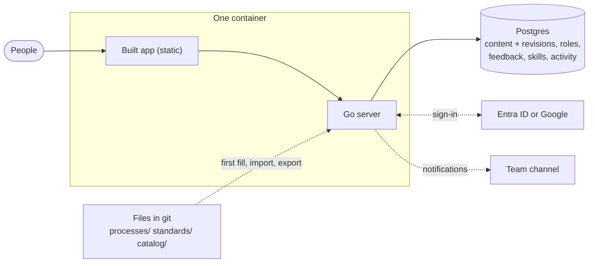

# Backend

Everything people change in the portal is stored in a database: processes, standards, the lists, roles, feedback and the generated skills. The server signs people in, enforces their rights, keeps every revision, and regenerates skills when their source changes.



## What the server does

| Area | Behaviour |
| --- | --- |
| Sign-in | OpenID Connect with **Entra ID** or **Google**, chosen by `PM_AUTH`. Locally, `PM_AUTH=dev` shows a user picker instead. The server sets a signed, HTTP-only session cookie (12 hours); the browser never sees a token. |
| Roles | Identity (name, email) comes from the provider. Roles are stored in the database and managed in the Admin panel. They are read on every request, so a change applies at once. |
| Content | Processes, standards and the lists (one document) are JSON documents in the database. Every save is a new revision; a delete is recorded too. Saving an unchanged document creates no revision. |
| Validation | Every save is checked against `schema/*.schema.json` (the same files the app uses). The app runs the full checker, including references, before it offers Save; the server is the safety net for the format and the rights. |
| Skills | After a save, the skills generated from that process or standard are regenerated. A new version is stored only when the text changed. Changing the lists regenerates everything, because names appear in the text. |
| Feedback | About a step of a process or a requirement of a standard. Anyone signed in can report and say "I hit this too". |
| Stale feedback | Each item remembers a fingerprint of the step or requirement it was written about. When that changes or disappears, the item is flagged "may already be fixed". |
| Notifications | New feedback is announced to the owning team or unit (name and contact from the lists); a fix is announced to the reporter. `PM_NOTIFY=log` writes them to the server log, `webhook` posts `{"text": …}` plus the event fields to a URL (a Slack incoming webhook accepts this as is). |
| Activity | Every change to content, lists, roles and skill guidance is recorded with who and when. |
| Protection | Every change needs the header `X-Requested-With: process-manager` (stops cross-site form posts), bodies are limited to 1 MB, ids are validated. |

### Roles

| Role | May | Scope |
| --- | --- | --- |
| *(everyone signed in)* | Read published content, tick steps, report, "I hit this too", delete own feedback, read and download skills | |
| `owner` | Mark fixed / reopen / delete feedback | Required: one team or unit; applies to what it owns |
| `process-editor` | Create, change and delete processes; manage their feedback; see their history; edit the guidance of their skills | All processes |
| `standards-editor` | The same for standards | Optional: one unit. Moving a standard to another unit needs the role for both. |
| `catalog-manager` | Change the lists | |
| `admin` | Everything, including roles, the activity log and the system page | |

- `PM_ADMINS` names the bootstrap admins. They are always admin and cannot be removed in the panel.
- Without bootstrap admins, the last admin in the database cannot be removed (409).
- A role limited to a team must name a team that exists in the lists.
- If the roles cannot be read, the request is treated as a consumer's.

## API

All under the same origin as the app. JSON in and out; errors are `{"error": "…"}`.

| Method and path | Purpose | Who |
| --- | --- | --- |
| `GET /api/me` | Who is signed in, their rights (`perms`), the provider | anyone |
| `GET /auth/login`, `GET /auth/callback` | Sign-in with Entra ID or Google | anyone |
| `POST /auth/dev/login` | Local development only: `{"email": "sam@example.com"}` | anyone |
| `POST /auth/logout` | End the session | signed in |
| `GET /api/processes`, `GET /api/standards`, `GET /api/catalog` | Current content | signed in |
| `PUT /api/processes/{id}`, `DELETE /api/processes/{id}` | Save or delete a process | process editors |
| `PUT /api/standards/{id}`, `DELETE /api/standards/{id}` | Save or delete a standard | standards editors of its unit |
| `PUT /api/catalog` | Save the lists | lists managers |
| `GET /api/history/{process\|standard\|catalog}/{id}` | Revisions: number, who, when, deleted | who may edit it; admins for deleted documents |
| `GET /api/history/{kind}/{id}/{version}` | The content of one revision | as above |
| `GET /api/feedback` | All feedback as `{process: {id: […]}, standard: {id: […]}}`, as the caller sees it (`mine`, `canManage`, `alsoHitByMe`, `stale`) | signed in |
| `POST /api/feedback` | `{"targetKind", "targetId", "itemId"?, "kind", "text"}` | signed in |
| `POST` / `DELETE /api/feedback/{id}/also-hit` | "I hit this too" on / off | signed in, not the author |
| `PATCH /api/feedback/{id}` | `{"resolved": true \| false}` | editors of the target, owners of its team |
| `DELETE /api/feedback/{id}` | Remove an item | as above, and the author |
| `GET /api/skills` | Every skill and review agent with its latest version number | signed in |
| `GET /api/skills/{id}` | Text, versions, extra guidance, `canEdit` | signed in |
| `GET /api/skills/{id}/versions/{n}` | The text of an older version | signed in |
| `GET /api/skills/{id}/download` | The latest text as a file (`SKILL.md` or `<id>.md`) | signed in |
| `PUT /api/skills/{id}/extra` | `{"extra": "…"}`: hand-written guidance, then regenerate | who may edit the source |
| `GET /api/admin/access` | Assignments, bootstrap admins, role names | admins |
| `POST` / `DELETE /api/admin/access` | `{"email", "role", "scope"}`: give or remove a role | admins |
| `GET /api/admin/audit?limit=` | The activity log, newest first | admins |
| `GET /api/admin/system` | Provider, address, counts | admins |
| `GET /healthz` | Liveness | anyone |

There is no machine-to-machine access yet: every call needs a browser session. Repositories get skills by download or through `npm run export`.

## Settings

| Variable | Meaning |
| --- | --- |
| `DATABASE_URL` | Postgres connection string. Required. |
| `PM_AUTH` | `entra`, `google` or `dev`. Required; there is no default, so a deployment cannot fall back to the dev picker by accident. |
| `PM_ADMINS` | Comma-separated emails of the bootstrap admins. Required with `entra` and `google`. With `dev` it defaults to `dana@example.com`. |
| `PM_BASE_URL` | Public address of the app. The redirect address to register with the provider is `<PM_BASE_URL>/auth/callback`. |
| `PM_SESSION_SECRET` | At least 32 characters. Signs the session cookie. |
| `PM_OIDC_CLIENT_ID`, `PM_OIDC_CLIENT_SECRET` | The app registration |
| `PM_ENTRA_TENANT` | Entra ID tenant id or domain. Single-tenant only. |
| `PM_GOOGLE_HOSTED_DOMAIN` | Optional: accept only accounts of this Google Workspace domain |
| `PM_OIDC_ISSUER` | Optional: override the issuer (sovereign clouds, tests) |
| `PM_SEED_DIR` | Folder with `processes/`, `standards/`, `catalog/` that fills an empty database, and with `schema/`. Default: the working directory. |
| `PM_SCHEMA_DIR` | Folder with the JSON schemas. Default: `<PM_SEED_DIR>/schema`. |
| `PM_STATIC_DIR`, `PM_ADDR` | The built app and the listen address; set by the `Dockerfile` and by `npm run dev` |
| `PM_NOTIFY`, `PM_NOTIFY_WEBHOOK_URL` | `log` (default) or `webhook` |

With Entra ID the email is read from `email`, then `preferred_username`, then `upn`. Emails are compared case-insensitively.

## Database

Postgres 16. The server creates and upgrades its tables on start (`server/internal/db/migrations/`); starting several instances at once is safe.

| Table | Holds |
| --- | --- |
| `documents` | The current revision of every process, standard and the lists. The body is `json` (not `jsonb`), so the order of the keys is kept. |
| `document_versions` | Every revision; a null body records a deletion |
| `role_assignments` | Email, role, scope, who gave it and when |
| `audit_log` | The activity log |
| `skills`, `skill_versions` | The registry and every generated version, with the revision of the source it came from |
| `feedback`, `feedback_also_hit` | Feedback and who else hit the same problem |

## Starting, importing, exporting

- **First start:** when `documents` is empty, the server imports `PM_SEED_DIR`. It never does so again, so content changed in the portal is not overwritten by a new deployment.
- **Development roles:** with `PM_AUTH=dev` and no roles stored, the built-in users get theirs (`server/internal/auth/dev.go`).
- **Every start:** the skills are brought in line with the content.

| Command | Does |
| --- | --- |
| `server -import <folder>` (`npm run db:import`) | Loads the files over what is stored: each changed file becomes a new revision. Nothing is deleted. |
| `server -export <folder>` (`npm run export -- <folder>`) | Writes content to `processes/`, `standards/`, `catalog/` and the active skills to `.claude/`. Files of deleted documents are removed. Use it as a backup or to commit. |
| `server -reset [-seed]` (`npm run db:reset`) | Deletes all feedback; `-seed` adds the samples again. |

## Deploying

`Dockerfile` builds one image with the server, the built app, the schemas and the sample content. It needs a Postgres database and the settings above; see `.env.example`. After the first start, changes are made in the portal and are live at once.

Not built yet: machine access for repositories and agents (API tokens, the MCP server in `docs/mcp.md`), mapping Entra or Google groups to roles, and per-person run tracking.

## Code map

```
server/cmd/server              start-up, seeding, flags (-import, -export, -seed, -reset)
server/internal/config         settings from the environment
server/internal/db             migrations; dbtest gives tests a real database
server/internal/auth           sessions, OpenID Connect, dev users
server/internal/auth/oidctest  fake provider that signs real tokens, for tests
server/internal/rbac           roles and what they allow
server/internal/docs           documents with revisions, import and export
server/internal/schema         JSON schema validation of saves
server/internal/skills         generators for skills and review agents; the registry
server/internal/feedback       feedback store
server/internal/audit          activity log
server/internal/notify         log and webhook notifiers
server/internal/httpapi        routes, permissions, views
```
