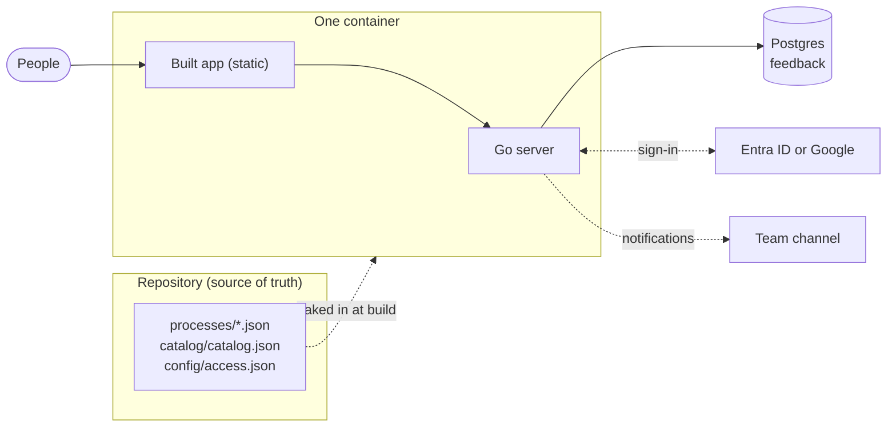

# Backend

The process descriptions stay in the repository. The backend adds only what files cannot do:
sign-in, permissions, and feedback from people who have no access to the repository.



| Lives in the repository | Lives in the database |
| --- | --- |
| Processes, catalog, schemas, checker, LLM prompt, skills | Feedback and who else hit the same problem |
| Who is an editor, who belongs to which team (`config/access.json`) | Nothing else yet |

## What the server does

| Area | Behaviour |
| --- | --- |
| Sign-in | OpenID Connect with **Entra ID** or **Google**, chosen by `PM_AUTH`. Locally, `PM_AUTH=dev` shows a user picker instead. The server sets a signed, HTTP-only session cookie (12 hours); the browser never sees a token. |
| Roles | Identity (name, email) comes from the provider. Rights come from `config/access.json`, so they work the same with either provider. |
| Content | Serves `processes/` and `catalog/` to signed-in users. Writing is refused unless `PM_CONTENT_WRITABLE=true` (local development) **and** the user is an editor. In a deployment, editors prepare a change in the app and download the file to commit. |
| Feedback | Stored in Postgres. Anyone signed in can report and say "I hit this too". Editors and members of the team that owns the process can mark it fixed, reopen or delete it; authors can delete their own. |
| Stale feedback | Each item remembers a fingerprint of the step it was written about. When that step changes or disappears, the item is flagged "may already be fixed". |
| Notifications | New feedback is announced to the owner team (name and contact from the catalog); a fix is announced to the reporter. `PM_NOTIFY=log` writes them to the server log, `webhook` posts `{"text": …}` plus the event fields to a URL (a Slack incoming webhook accepts this as is). |
| Protection | Every change needs the header `X-Requested-With: process-manager` (stops cross-site form posts), bodies are limited to 1 MB, ids are validated before they touch the file system. |

### Rights

```json
{
  "editors": ["alex@example.com"],
  "teams": { "cloud-platform-team": ["casey@example.com"] }
}
```

| | Consumer | Member of the owner team | Editor |
| --- | :-: | :-: | :-: |
| Read processes, tick steps, report, "I hit this too" | ✓ | ✓ | ✓ |
| Delete own feedback | ✓ | ✓ | ✓ |
| Mark fixed / reopen / delete feedback on **their** processes | | ✓ | ✓ |
| The same on any process | | | ✓ |
| Editor view; change processes and lists (where writable) | | | ✓ |

A missing or broken access file grants nobody anything extra; reading still works and the problem is logged.

## API

All under the same origin as the app. JSON in and out; errors are `{"error": "…"}`.

| Method and path | Purpose |
| --- | --- |
| `GET /api/me` | Who is signed in, their rights, the provider, whether content is writable. Open to anonymous callers. |
| `GET /auth/login`, `GET /auth/callback` | Sign-in with Entra ID or Google |
| `POST /auth/dev/login` | Local development only: `{"email": "sam@example.com"}` |
| `POST /auth/logout` | End the session |
| `GET /api/processes`, `GET /api/catalog` | The content files |
| `PUT /api/processes/{id}`, `DELETE /api/processes/{id}`, `PUT /api/catalog` | Change content (editors, writable deployments only) |
| `GET /api/feedback` | All feedback, grouped by process, as the caller sees it (`mine`, `canManage`, `alsoHitByMe`, `stale`) |
| `POST /api/feedback` | `{"processId", "stepId"?, "kind", "text"}` |
| `POST` / `DELETE /api/feedback/{id}/also-hit` | "I hit this too" on / off |
| `PATCH /api/feedback/{id}` | `{"resolved": true \| false}` |
| `DELETE /api/feedback/{id}` | Remove an item |
| `GET /healthz` | Liveness |

## Settings

| Variable | Meaning |
| --- | --- |
| `DATABASE_URL` | Postgres connection string. Required. |
| `PM_AUTH` | `entra`, `google` or `dev`. Required; there is no default, so a deployment cannot fall back to the dev picker by accident. |
| `PM_BASE_URL` | Public address of the app. The redirect address to register with the provider is `<PM_BASE_URL>/auth/callback`. |
| `PM_SESSION_SECRET` | At least 32 characters. Signs the session cookie. |
| `PM_OIDC_CLIENT_ID`, `PM_OIDC_CLIENT_SECRET` | The app registration |
| `PM_ENTRA_TENANT` | Entra ID tenant id or domain. Single-tenant only. |
| `PM_GOOGLE_HOSTED_DOMAIN` | Optional: accept only accounts of this Google Workspace domain |
| `PM_OIDC_ISSUER` | Optional: override the issuer (sovereign clouds, tests) |
| `PM_CONTENT_DIR`, `PM_CONTENT_WRITABLE`, `PM_ACCESS_FILE`, `PM_STATIC_DIR`, `PM_ADDR` | Set by the `Dockerfile` and by `npm run dev`; rarely changed by hand |
| `PM_NOTIFY`, `PM_NOTIFY_WEBHOOK_URL` | `log` (default) or `webhook` |

With Entra ID the email is read from `email`, then `preferred_username`, then `upn`. Emails are compared case-insensitively.

## Database

Postgres 16. The server creates and upgrades its tables on start (`server/internal/feedback/migrations/`); starting several instances at once is safe. Two tables: `feedback` and `feedback_also_hit`.

## Deploying

`Dockerfile` builds one image with the server, the built app and the content of the repository at that commit. A new version of a process therefore goes live by merging to `main` and deploying the new image. The image needs a Postgres database and the settings above; see `.env.example`.

Not built yet: saving from the browser as a pull request, the MCP server (`docs/mcp.md`), and per-person run tracking.

## Code map

```
server/cmd/server            start-up, flags (-seed, -reset)
server/internal/config       settings from the environment
server/internal/auth         sessions, roles, OpenID Connect, dev users
server/internal/auth/oidctest  fake provider that signs real tokens, for tests
server/internal/content      reading and writing the process and catalog files
server/internal/feedback     Postgres store and migrations
server/internal/notify       log and webhook notifiers
server/internal/httpapi      routes, permissions, views
```
