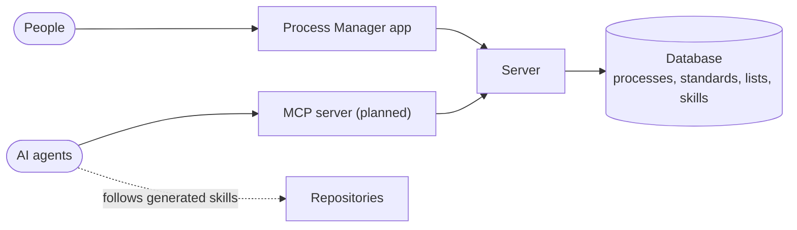

# Consuming the portal over MCP (planned)

> **Status: design only.** No MCP server exists in this repository yet. This document fixes the contract so that the data model, the app and future agents move in the same direction.

## Why

Process Manager holds one description of each process and each standard. People read them in the app. AI agents should read the **same** content, so that "how do I get a GCP project" and "what must my service meet" have one answer whether a person or an agent asks. The [Model Context Protocol](https://modelcontextprotocol.io) (MCP) is the standard way to give an agent that access.

## What exists today

Agents already get the knowledge as **generated skills** (see `docs/backend.md` and the Guide):

- a skill per active process ("follow this process for a person"),
- a skill per active standard ("write code that complies"),
- a review agent per standard that has review hints ("check this pull request").

They are downloaded from the portal or written to files with `npm run export -- <folder>`, and committed to the repository the agent works in. They are a snapshot: each names its version and the version of its source.

## What the MCP server will expose

Read-only except for feedback. Content follows `schema/process.schema.json`, `schema/standard.schema.json` and `schema/catalog.schema.json`.

| Tool | Input | Returns |
| --- | --- | --- |
| `search_processes` | `query?`, `category?`, `practice?`, `platform?`, `rigour?`, `tier?`, `environment?`, `language?` | Matching **active** processes: `id`, `title`, `summary`, `owner`, `category`, `practice`, `platform`, `rigour`, where they apply, review state. A process without `tiers` / `environments` / `languages` matches every one. |
| `search_standards` | `query?`, `owner?`, `category?`, `practice?`, `platform?`, `rigour?`, `tier?`, `environment?`, `language?` | Matching **active** standards, with the requirements that apply to that profile. A standard matches a `rigour` when at least one of its requirements has that level (`must` = mandatory, `should` = recommended, `may` = optional). |
| `get_process` | `id` | The complete process with its version number, with team, category, practice, platform and tool ids resolved to names, contacts and links. |
| `get_standard` | `id`, profile? | The complete standard with its version number; with a profile, only the requirements that apply. |
| `get_my_steps` | `id`, `actor?` (default `me`) | Only that participant's steps in flow order, with `instructions`, `tool`, `url`, `outcome`, `resources`, and what it waits for before and after. |
| `get_skill` | `id`, `version?` | The text of a generated skill or review agent, latest by default, with its version. |
| `get_catalog` | – | Teams, practices and platforms (with contact and members), categories, tools (with link), tiers, environments, languages. |
| `report_problem` | `targetKind`, `targetId`, `itemId?`, `kind`, `text` | Files feedback on behalf of the person the agent acts for, the same as the flag in the app. |

It needs something the server does not have yet: access for machines (tokens tied to a person or a repository). Today every API call needs a browser session.

## Measuring use by agents

Today the portal counts **skill downloads** as the use by AI assistants: a download of a skill or review agent from the portal counts one for its process or standard, at most once per person, skill and day, and every run of `npm run export` counts one per skill it writes. The count is shown on each process and standard and in Admin › Statistics. It says how often a skill was fetched, not how often an assistant followed it afterwards.

With the MCP server (planned, not built) every tool call names the process or standard it is about, so the portal could count what agents actually look up and follow, next to the views of people. Nothing of this is counted yet.

## Rules an agent must be able to rely on

- `actors[0]` of a process is always `me`: the party the agent acts for.
- A step with `subProcessId` is described by another process.
- Steps of type `approval`, and anything done by an actor other than `me`, are **not** for the agent to perform. It waits and reports.
- A process with `rigour: "mandatory"` is the only allowed way to get its result; the agent does not look for another.
- A requirement of level `must` cannot be waived by the agent. If it cannot be met, the agent stops and tells the person; exceptions go through `exceptionProcessId`.
- A requirement with `tiers`, `environments` or `languages` applies only there.
- `status: "deprecated"` means do not follow it; use `replacedBy` when present. Drafts are never returned.
- A process or standard whose review is overdue is still returned, marked as such, so the agent can warn the person.

## Where this leads

The planned next stage is an agent that follows a process for a person: look it up over MCP, do the `me` steps with the linked skills, ask the person to approve, track the other lanes. See the "Planned: automation" section of the in-app Guide.
