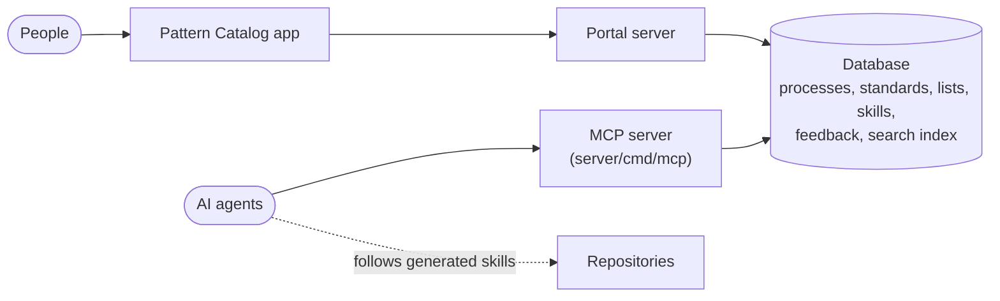

# Consuming the portal over MCP

Pattern Catalog holds one description of each process and each standard. People read them in the app. AI agents read the **same** content through an MCP server, so that "how do I get a GCP project" and "what must my service meet" have one answer whether a person or an agent asks. The [Model Context Protocol](https://modelcontextprotocol.io) (MCP) is the standard way to give an agent that access.



The MCP server is a separate program in the same Go module (`server/cmd/mcp`, code in `server/internal/mcpserver`). It reads the portal's database with the portal's settings. It never creates or upgrades tables: it refuses to start, with a plain message, when the portal server has not prepared the database (no tables, or tables of an older version). The only thing it writes is feedback (`report_problem`).

Agents also get the knowledge as **generated skills** (see `docs/backend.md` and the Guide): a skill per active process, a skill per active standard and a review agent per standard with review hints. They are downloaded from the portal, written to files with `npm run export -- <folder>`, or read with `get_skill`.

## Running it

| | |
| --- | --- |
| `npm run mcp` | Builds and starts the MCP server against the development database, with the settings of `npm run dev` (search by meaning with `builtin`). Start `npm run dev` once first: the portal server creates and fills the database. It prints the address and an example client configuration. |
| `go run ./cmd/mcp` (in `server/`) | The same by hand; settings from the environment. |
| `docker run --entrypoint /app/mcp …` | Deployed: the portal's image holds the MCP server as `/app/mcp` (in Kubernetes `command: ["/app/mcp"]`). Run it as a second container next to the portal, with the same database and the same search settings, `PM_MCP_ADDR=0.0.0.0:8081` and a `PM_MCP_SECRET` (in a container it must listen beyond its own machine). |

Endpoints: `POST /mcp` (streamable HTTP, [official Go SDK](https://github.com/modelcontextprotocol/go-sdk) v1.8.0) and `GET /healthz` (`ok`, or 503 when the database cannot be reached; it needs no secret and says nothing else). The server is stateless: every request stands on its own, nothing is kept between calls. A `GET /mcp` (a stream of messages from the server) is answered with 405, as the protocol allows: the server never sends anything on its own.

### Settings

| Variable | Default | |
| --- | --- | --- |
| `DATABASE_URL` | – | The portal's database. Required. |
| `PM_MCP_ADDR` | `127.0.0.1:8081` | Where to listen. Without `PM_MCP_SECRET` only an address of this machine is accepted. |
| `PM_MCP_SECRET` | – | One shared secret, at least 32 characters, not a placeholder (`openssl rand -base64 48`). With it, every call must carry `Authorization: Bearer <secret>`. |
| `PM_BASE_URL` | `http://localhost:5173` | The portal's address, for links in answers and notifications. |
| `PM_NOTIFY`, `PM_NOTIFY_WEBHOOK_URL` | `log` | How the owning team hears about a reported problem: as in the portal. |
| `PM_ALLOWED_EMAIL_DOMAINS`, `PM_GOOGLE_HOSTED_DOMAIN` | – | As for the portal's sign-in: when set, `X-PM-Person` must be an address of one of these domains (exactly that domain). |
| `PM_EMBEDDINGS` and the other settings of search by meaning | `off` | As in the portal (`docs/backend.md`). They must be the same as the portal server's: the portal server builds the search index, the MCP server only reads it. |
| `PM_LOG_FORMAT` | `text` | `text` or `json`. |

At start it logs where it listens, whether a secret is required, whether search by meaning is on and with which provider, and whether text leaves the company. With `PM_EMBEDDINGS=vertex` **every search query of an agent is sent to Google Vertex AI** to be turned into a vector; the log says so. What else leaves the company with Vertex AI, and what has to be checked before its first real use, is in `docs/backend.md` (Search by meaning).

The server speaks plain HTTP. When it listens beyond this machine, set `PM_MCP_SECRET` and put it behind a proxy that adds HTTPS, so that the secret and the person headers do not travel in the clear.

## The guard (until agents sign in)

Sign-in for agents is not built (see below). Until then two rules stand in for it:

- **Without `PM_MCP_SECRET`** the server refuses to start on an address other than this machine (`127.0.0.1`, `::1`, `localhost`), and refuses calls that do not come from this machine (`403`). Anything running on the machine can call it. The person headers are ignored, so the server is read-only. Do not put a proxy on the same machine in front of it without a secret: every call through that proxy comes from this machine and would be accepted.
- **With `PM_MCP_SECRET`** it may listen anywhere, and every call must carry `Authorization: Bearer <secret>` (the word `Bearer` in any case). A missing or wrong secret gets `401` with the same answer either way; the comparison takes the same time whatever was sent.

Whoever holds the secret can file feedback in anyone's name (within the sign-in domains) and read the emails of the owners and members of teams, platforms and practices: the secret stands in for the gateway and must be guarded like one.

**The person an agent acts for**: header `X-PM-Person: <email>` (and optionally `X-PM-Person-Name: <name>`). It is honoured **only** with the secret configured and presented; a value that is not an email address, or not of the sign-in domains (`PM_ALLOWED_EMAIL_DOMAINS`, `PM_GOOGLE_HOSTED_DOMAIN`, when set), is refused with `400`. `X-PM-Person-Name` is used when it is one line of at most 60 characters without control or direction characters; otherwise feedback shows the part of the email before the @. Only then is `report_problem` listed and callable. The server cannot check that the email is really the person's: whoever holds the secret is trusted to name the right person.

**Owners and members of teams, platforms and practices** (their emails) are given by `get_catalog` only to callers that present the secret: `members` are the owners (of a team, the `owner` role; of a platform or practice, its owners), `drafters` on platforms and practices are their members, who write drafts an owner publishes (always a list, possibly empty, with the secret; left out without it). In the portal they are shown to everyone signed in; an agent on this machine that nobody vouched for is not signed in, so it gets the lists without the people.

### Consequences of running without a gateway

- Everyone who can reach the server reads every published process and standard, the lists and the generated skills. Without a secret that is everyone on the machine; with one, everyone who has the secret. Nothing is limited per person.
- With the secret, whoever holds it can file feedback in the name of anyone of the sign-in domains, up to the limit of 30 items per person and hour.
- Nothing records which agent or person read what.
- One secret for all: to take access away from one agent the secret has to change for all of them.
- Drafts stay hidden in every case: they are never returned, and an agent cannot tell a draft from something that does not exist. Unpublished changes to a published process or standard (its working draft) are never read: agents get the published version, as readers do.

## Tools

Every tool returns structured content (with an output schema) and two text blocks: a short sentence for people reading along, and the same structured content as JSON for clients that do not read structured results. Errors are plain sentences an agent can act on, e.g. "There is no process “x”. Use search_processes to find the id." A tool that fails unexpectedly answers "Something went wrong on the server. Try again later." and the server keeps running. Every call is answered within 45 seconds. Queries, emails and the secret are not written to the log.

Everywhere: list ids (teams, categories, practices, platforms, tools, tiers, paths, environments, languages, architecture patterns) are resolved to names, with how to reach teams, practices and platforms (`contact`, the free line, and `contacts`, each way on its own: `email` (group email), `slack` (channel name), `slackUrl`, `chat` (Google Chat space), `chatUrl`, `confluence`, `page` (their own page), `form` (where to ask them for something); left out when not given; links are always `http(s)`) and the link of tools; other processes and standards are named by id and title (a draft by its id only); every document carries its `version`, its `link` in the portal, its `review` state (`{state, overdue, dueAt?, lastReviewedAt?, intervalMonths?, label}`: `state` is `none`, `ok`, `soon` (due within 30 days) or `overdue`, and `review.overdue: true` when the owner has not confirmed it in time; worked out as the portal does, so a document never reviewed counts its first review from when it was first published, with the label "First review due …" until it is overdue, and "Never reviewed" only when that time is not known; an agent has no day of its own, so the server counts in UTC days: today is the UTC day and a first publication counts from its UTC day, while the portal counts in the reader's own day, so for a few hours around midnight a review can be due or overdue a day earlier or later here than a person far from UTC sees it in the portal) and, when retired, `retired: true` and `replacedBy`. Every document also carries `paths`: the paths it is made for, as `[{id, name, alsoCalled?, description?}]` (`alsoCalled`: the entry's other names, such as "golden path" for the paved path), `[]` when it names none; a document names paths only when it is meant only for that kind of work, and empty means it applies whatever the path, which is most documents. Every document also carries `patterns`: the architecture patterns it is tagged with, as `[{id, name, alsoCalled?, description?}]` (`alsoCalled` such as "EDA" for event-driven), `[]` when it is tagged with none; a pattern is only a tag (what the document is about), never a limit. There is no search parameter for patterns: `path` means "applies to", and a "tagged with" filter beside it would mix two meanings; the word search and search by meaning find a document by its patterns' names and other names. Pillars, tribes and domains (groups of teams) are not given to agents. A `notice` sentence says what the agent must tell the person.

| Tool | Input | Returns |
| --- | --- | --- |
| `search_processes` | `query?`, `category?`, `practice?`, `platform?`, `owner?`, `rigour?`, `tier?`, `environment?`, `language?`, `path?`, `limit?` (1–50, default 10) | **Active** processes: id, title, summary, version, owner, category, practice, platform, rigour, where they apply, review state, link; with a query the `score` and up to three `matches` (part, step id, label, snippet). `total` (with `totalAtLeast: true` when search by meaning matched more than the 500 documents it returns, so `total` is a lower bound), `rankedBy` (`meaning`, `words`, `words-fallback` or `title`), a `note` when it fell back, and the filters as understood. |
| `search_standards` | the same | **Active** standards, with the requirements that apply (id, title, level). A standard matches a `rigour` when a requirement that applies has that level (`must` = mandatory, `should` = recommended, `may` = optional). |
| `get_process` | `id` | The complete published process: prerequisites, actors (the first is always `me`), every step with instructions, tool, link, outcome, sub-process, the service it requests (`service`: `{id, name, summary?, team, form, formLabel, description?}`, the description as plain text), resources and what follows, `agentMayDo` per step, the standards it helps to meet, its skills. |
| `get_standard` | `id`, `tier?`, `environment?`, `language?` | The complete published standard: scope, exception process, every requirement with level, statement, rationale, guidance, examples, verification, what a reviewer looks for. With a profile only the requirements that apply, and `leftOut` says how many were left out. |
| `get_my_steps` | `id`, `actor?` (id or name, default `me`) | Only that participant's steps in the order the process flows (from the first step along `next`), each with what it waits for (`before`) and what follows (`after`). |
| `get_skill` | `id` (e.g. `process-request-gcp-project`, from `skills` of get_process / get_standard), `version?` | The text of a generated skill or review agent, latest by default, with its version, the version of its source and `active`. The skill of a draft does not exist. |
| `get_catalog` | – | Teams, practices and platforms (with their description, `contact` and `contacts`; with the secret also `members`, and `drafters` for platforms and practices), categories, tools (with link), tiers, `paths` (greenfield, brownfield, paved path and any the company added, each `{id, name, alsoCalled?, description?}`), environments, languages, `patterns` (the architecture patterns, each `{id, name, alsoCalled?, description?}`; `[]` when the company lists none), `services` (what teams do on request, each `{id, name, summary?, team, form, formLabel, description?}`: the team that performs it, the front-door form, the button's words and the description as plain text, never HTML; `[]` when the company lists none). The text answer ends with how many of each, "…, 6 architecture patterns, 6 services." |
| `report_problem` | `targetKind`, `targetId`, `itemId?`, `kind` (`broken`, `outdated`, `unclear`, `idea`), `text` | Only listed when acting for a person. Files feedback as that person, through the same checks as the flag in the portal: the text check, 3–2000 characters, a published process or standard, an existing step or requirement, at most 30 items per person and hour, counted together with the portal and holding for reports sent at the same moment. The owning team is notified as from the portal, with everything about how to reach it ("Group email: …; Slack: #cloud-platform (https://…)"). |

**Filters** take ids or names, in any case and with or without accents ("Google Cloud", `google-cloud`). An unknown value is refused and names the list to look in. A document without `tiers`, `environments` or `languages` applies to all of them.

**`path`** is the id, name or one of the other names of the path the work is on ("greenfield", "Paved path", "golden path"). It means **applies to that path**, as My application does in the portal: what is made for it **and** what names no path (most documents, as they apply to everyone); only what is made only for other paths is left out. This differs from the portal's **Path** filter, which keeps only what is made for the chosen path. An unknown path is refused with the known ones. It is shown as `filters.path`.

**Search**: with a `query` and search by meaning switched on, results are ranked by the portal's search index (`rankedBy: "meaning"`), each with the parts that matched, pointing at the exact step or requirement. Search by meaning gets about 5 seconds; when it does not answer in time, the index is not ready (not built yet, not in use, or built with other settings) or its provider cannot be reached, the tool answers with the portal's word match instead (`rankedBy: "words-fallback"`, with a `note` saying why). With search by meaning off it is the word match (`rankedBy: "words"`): every word must be found in the title, id, tags, the names of category, practice, platform, owner and the paths (with their other names), the summary, or a step, prerequisite, requirement or the scope. Searches that would use the embeddings provider are limited to 60 a minute per person (or, without one, per calling address); beyond that the tool answers "Too many searches in the last minute (at most 60). Try again in N seconds." The MCP server never builds or changes the index: it only searches one the portal server built with the same settings. Without a query everything that passes the filters is listed by title.

## Connecting a client

A client that speaks streamable HTTP needs the address and, when a secret is set, the header. For example, a project's `.mcp.json` for Claude Code:

```json
{
  "mcpServers": {
    "process-manager": {
      "type": "http",
      "url": "http://127.0.0.1:8081/mcp",
      "headers": {
        "Authorization": "Bearer ${PM_MCP_SECRET}",
        "X-PM-Person": "sam@example.com"
      }
    }
  }
}
```

Leave out `headers` when the server runs without a secret on the same machine; leave out `X-PM-Person` for read-only use. Keep the secret in an environment variable, never in a file in a repository.

## Rules an agent must be able to rely on

The server gives these to every agent when it connects (its instructions):

- `actors[0]` of a process is always `me`: the party the agent acts for.
- A step with a sub-process is described by another process.
- A step with a service requests a service another team performs: the person requests it through its front-door form (`service.form`); the agent does not do the team's work. The server's name for clients is `process-manager` (a machine name, unchanged); its title is "Pattern Catalog".
- Steps of type `approval`, and anything done by an actor other than `me`, are **not** for the agent to perform (`agentMayDo: false`). It waits and reports.
- A process with `rigour: "mandatory"` is the only allowed way to get its result; the agent does not look for another.
- A requirement of level `must` cannot be waived by the agent. If it cannot be met, the agent stops and tells the person; exceptions go through the standard's exception process.
- A requirement with `tiers`, `environments` or `languages` applies only there.
- A document's paths say which kind of work it is meant only for: greenfield (something new), brownfield (something that exists), paved path (the golden path: the ready-made way); empty means it applies whatever the path, which is most documents. Pass `path` to get what applies to that path.
- `status: "deprecated"` (`retired: true`) means do not follow it; use `replacedBy` when present. Drafts are never returned.
- A process or standard whose review is overdue is still returned, marked as such, so the agent can warn the person. The review state is counted in UTC days; near midnight the portal may show the person a state one day apart, while the date (`dueAt`, and the `label` such as "Review overdue since 2026-11-23") is the same for both, so it is the safer thing to pass on.

## Planned

- **Sign-in through a dedicated MCP gateway** (planned, not built). Agents will sign in as a person or a repository; the gateway will pass on who calls, and the shared secret and the person header will no longer be needed. Until then the guard above applies.
- **Counting use by agents** (planned, not built). Today the portal counts **skill downloads** as the use by AI assistants: a download from the portal counts one for its process or standard, at most once per person, skill and day, and every run of `npm run export` counts one per skill it writes. Calls to the MCP server are **not** counted: neither as views nor as downloads. Every tool call names the process or standard it is about, so the portal could later count what agents actually look up, next to the views of people.

## Where this leads

The planned next stage is an agent that follows a process for a person: look it up over MCP, do the `me` steps with the linked skills, ask the person to approve, track the other lanes. See the "Planned: automation" section of the in-app Guide.
