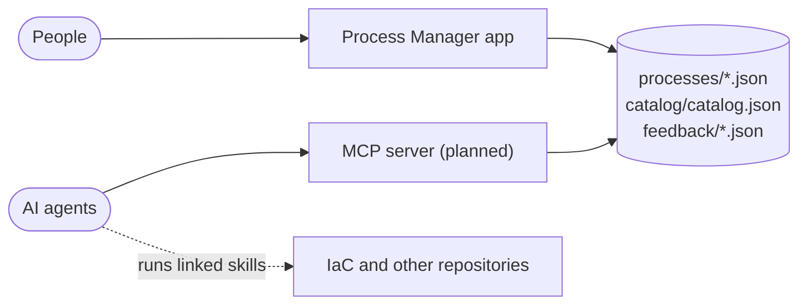

# Consuming the process catalog over MCP (planned)

> **Status: design only.** No MCP server exists in this repository yet. This document fixes the contract so that the data model, the app and future agents move in the same direction.

## Why

Process Manager holds one description of each process. People read it in the app. AI agents should read the **same** description, so that "how do I get a GCP project" has one answer whether a person or an agent asks. The [Model Context Protocol](https://modelcontextprotocol.io) (MCP) is the standard way to give an agent that access.

## What the server exposes

Read-only except for feedback. Every tool returns JSON that follows `schema/process.schema.json` and `schema/catalog.schema.json`.

| Tool | Input | Returns |
| --- | --- | --- |
| `search_processes` | `query?`, `tier?`, `language?`, `category?` | Matching **active** processes: `id`, `title`, `summary`, `owner`, `tiers`, `languages`, `estimatedDuration`, review state. A process without `tiers` / `languages` matches every tier / language. |
| `get_process` | `id` | The complete process, with team and tool ids resolved to names, contacts and links. Includes `status`, `replacedBy` and `review`. |
| `get_my_steps` | `id`, `actor?` (default `me`) | Only that participant's steps in flow order, each with `instructions`, `tool`, `url`, `outcome`, `resources`, and what it waits for before and after. |
| `get_catalog` | – | Teams (with contact), tools (with link), tiers, languages. |
| `report_problem` | `processId`, `stepId?`, `kind`, `text`, `author` | Appends an entry to `feedback/<processId>.json`, the same as the flag in the app. |

Resources (for clients that prefer browsing to tool calls):

- `process://<id>` – one process as JSON
- `catalog://teams`, `catalog://tools`, `catalog://tiers`, `catalog://languages`

## Rules an agent must be able to rely on

- `actors[0]` is always `me`: the party the agent acts for.
- A step with `subProcessId` is described by another process; fetch it with `get_process`.
- `resources` with `kind: "skill"` point to instructions the agent can run to do the step in self-service (for example, a skill that adds a file to the IaC repository and opens a pull request). A skill on a step applies to that step; a skill on the process applies to the whole.
- `status: "deprecated"` means do not follow it; use `replacedBy` when present. Drafts are never returned.
- A process whose review is overdue is still returned, with `review.state: "overdue"`, so the agent can warn the person.
- Steps of type `approval`, and anything done by an actor other than `me`, are **not** for the agent to perform. It waits and reports.

## Until the server exists

An agent with access to this repository can already consume the catalog:

1. List `processes/*.json`; read `id`, `title`, `summary`, `tiers`, `languages`, `status` to choose one.
2. Read the chosen file. Field meanings are in `schema/process.schema.json`.
3. Resolve `owner`, `teamId` and `tool` ids in `catalog/catalog.json`.
4. Follow the steps whose `actor` is `me`, in the order given by `next`.

The skills in `.claude/skills/` (`edit-process`, `manage-catalog`) cover changing the data; `npm run validate` checks it.

## Where this leads

The planned next stage is an agent that follows a process for a person: look it up over MCP, do the `me` steps with the linked skills, ask the person to approve, track the other lanes. See the "Planned: automation" section of the in-app Guide.
